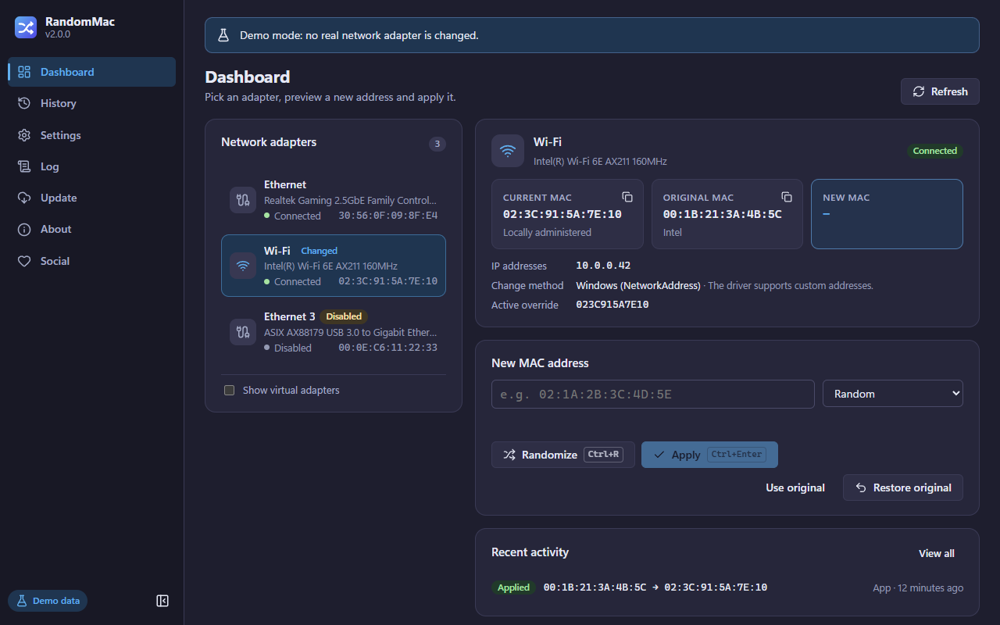
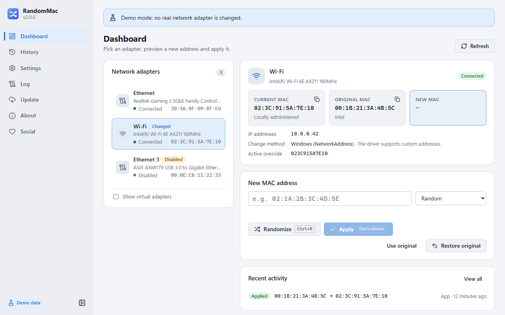
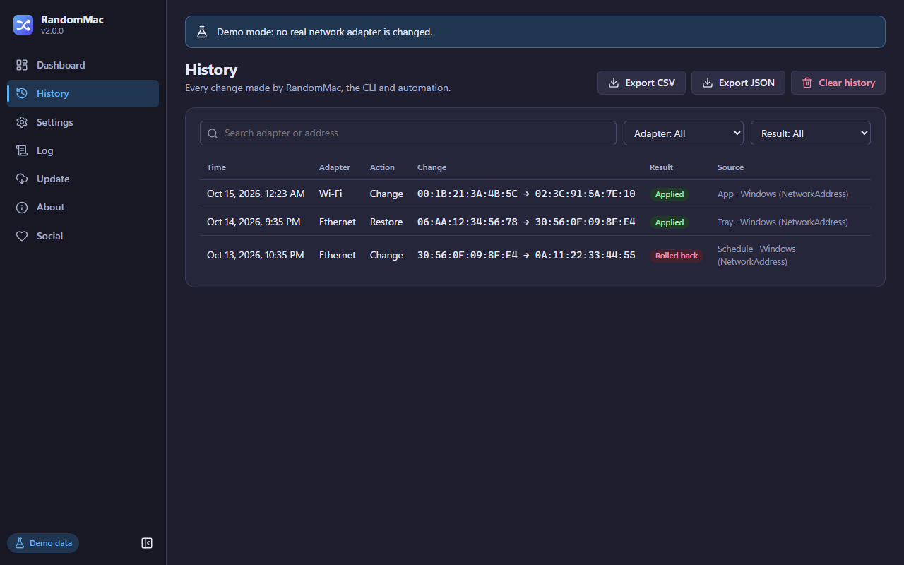
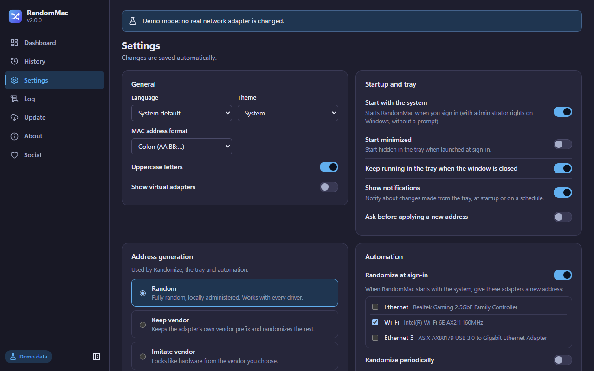
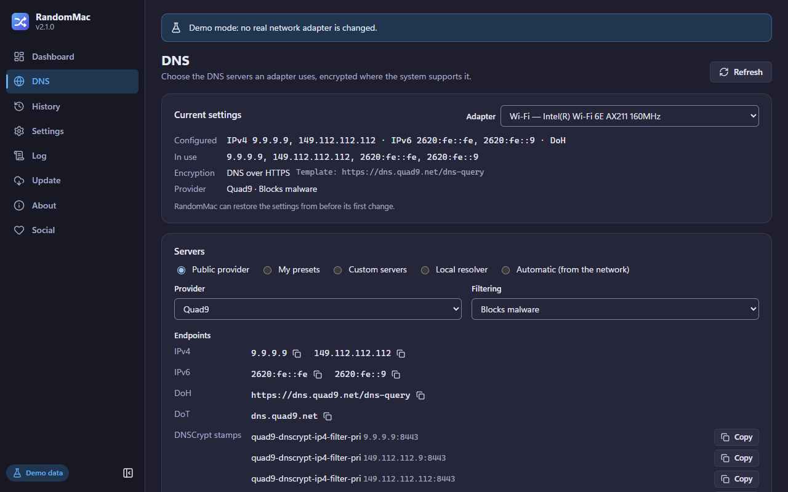

# RandomMac

[](https://github.com/poli0981/randomizerMAC/actions/workflows/ci.yml)
[](https://github.com/poli0981/randomizerMAC/actions/workflows/qodana.yml)
[](https://sonarcloud.io/summary/overall?id=poli0981_randomizerMAC)
[](https://sonarcloud.io/component_measures?id=poli0981_randomizerMAC&metric=coverage)
[](https://github.com/poli0981/randomizerMAC/releases/latest)
[](#project-status)
[](LICENSE)


RandomMac changes the MAC address of your Ethernet and Wi-Fi adapters, so networks you don't control
can't recognize your device by its hardware address. It also sets the DNS servers each adapter
uses — a public provider, with or without filtering, or your own — encrypted where the system
supports it. It is a small desktop app for **Windows 10/11 and Linux (Ubuntu, Fedora and other
distributions)**, with a command-line tool for scripts.

> **v2.0.0 is a complete rewrite** (Rust + Tauri 2 instead of .NET/WinUI 3): Linux support, a CLI,
> installers that are ~20× smaller, signed automatic updates and many fixes. Coming from 1.x? See
> [Upgrading from 1.x](#upgrading-from-1x). Vietnamese: [README tiếng Việt](docs/i18n/vi/README.md).



<details>
<summary>More screenshots (light theme, history, settings)</summary>





</details>

<sub>Screenshots use the built-in demo data; no real adapter is shown.</sub>

## Project status

RandomMac has been in **maintenance mode** since 2.1.0 (November 2026), its last feature release.
It is still maintained, and these changes still land:

- dependency updates;
- security fixes: dependencies with a high or critical CVE and serious security issues in runtimes
  such as Node.js — and a new feature only when it is genuinely necessary;
- major upgrades of a language, runtime or framework (for example Node.js 24 → 26 or TypeScript
  6 → 7);
- bug fixes, UI/UX and accessibility fixes;
- language fixes: wording that does not fit a culture or regional dialect, and spelling mistakes
  that make a text misleading.

Feature requests and `feat:` pull requests from outside contributors are closed automatically with
the `out-of-scope` label. Ideas are still welcome in
[Discussions → Ideas](https://github.com/poli0981/randomizerMAC/discussions/categories/ideas).
Details: [CONTRIBUTING.md → Maintenance mode](CONTRIBUTING.md#maintenance-mode).

## Features

- **New address in two clicks.** Generate a preview, check its vendor and warnings, then apply.
  Every change is verified; if the driver ignores it, RandomMac rolls it back and tells you why.
- **Generation modes.** Random (locally administered — works with every driver, the default),
  *keep the current vendor*, or *imitate a vendor* (Apple, Samsung, Intel… 59 vendors, 11k prefixes
  from the IEEE registry). Type your own address in any common notation if you prefer.
- **Real original address.** The hardware (permanent) address is read from the driver, so
  **Restore** works at any time — also for addresses set by another tool or by RandomMac 1.x.
  Privacy features of the operating system (Windows *random hardware addresses*, NetworkManager's
  `random`/`stable` modes) are left alone.
- **Automation.** Change selected adapters when you sign in, every *N* minutes while the app runs,
  and optionally restore everything when RandomMac exits. **Restore all** is one click away in the
  tray.
- **Blacklist.** Block exact addresses or vendor prefixes, globally or per adapter; import/export.
- **DNS servers per adapter.** Built-in providers with their filtering variants — Cloudflare,
  Google, Quad9, AdGuard, CleanBrowsing, Control D, DNS4EU, DNS.SB and Cisco OpenDNS — or your own
  servers, for IPv4 and IPv6. Encrypted where the system supports it: DNS over HTTPS on Windows 11
  and Windows Server 2022 or later, DNS over TLS on Linux when NetworkManager uses
  systemd-resolved. DNSCrypt stamps to copy into a client such as dnscrypt-proxy, and a *local
  resolver* choice (`127.0.0.1` / `::1`) that points the adapter at it. Latency test, presets,
  *Restore original* and a DNS submenu in the tray. Every change is verified, rolled back if the
  system does not keep it, and recorded in the history.
- **History.** Every change made by the app, the CLI or automation (MAC addresses and DNS), with
  search, a MAC/DNS filter and CSV/JSON export.
- **Command-line tool.** `randommac-cli list | show | random | set | restore | inspect | vendors |
  dns | history`, with `--json` output and stable exit codes.
- **Linux done properly.** NetworkManager (persistent, per connection) or iproute2 (temporary), with
  polkit prompts only when needed — the window itself never runs as root.
- **Comfortable UI.** Light/dark/system theme, English and Vietnamese, keyboard shortcuts, tray
  menu, desktop notifications, live log viewer, diagnostics you can paste into a bug report.
- **Private by design.** No telemetry. The only automatic network request is the update check,
  which you can turn off. DNS test queries are sent only when you run the latency test or switch to
  plain DNS servers.

## Download

Get the files from the [latest release](https://github.com/poli0981/randomizerMAC/releases/latest).

| System | File | Notes |
|---|---|---|
| Windows 10/11 (x64) | `RandomMac_<version>_x64-setup.exe` | Recommended. Installs for all users in `Program Files`. |
| Windows 10/11 (x64) | `RandomMac_<version>_x64_en-US.msi` | For managed/silent deployment. |
| Ubuntu 24.04+, Debian 13+ | `RandomMac_<version>_amd64.deb` | Installs `randommac` and `randommac-cli`. |
| Fedora 41+ | `RandomMac-<version>-1.x86_64.rpm` | Installs `randommac` and `randommac-cli`. |
| Other Linux (x86_64) | `RandomMac_<version>_amd64.AppImage` | Portable; updates itself. |
| CLI only | `randommac-cli-<version>-<target>.zip` / `.tar.gz` | Single executable, no GUI. |

### Install

**Windows** — run the setup file. The installer is not code-signed yet, so SmartScreen may say
*"Windows protected your PC"*: choose **More info → Run anyway** after
[verifying the download](#verify-your-download). If the WebView2 runtime is missing (rare on
Windows 10, built into Windows 11), the installer downloads it.

**Ubuntu / Debian**

```bash
sudo apt install ./RandomMac_2.1.0_amd64.deb
```

**Fedora**

```bash
sudo dnf install ./RandomMac-2.1.0-1.x86_64.rpm
```

**AppImage**

```bash
chmod +x RandomMac_2.1.0_amd64.AppImage
./RandomMac_2.1.0_amd64.AppImage
```

### Verify your download

Every release has a `SHA256SUMS.txt` and a [build provenance attestation](https://docs.github.com/actions/security-guides/using-artifact-attestations-to-establish-provenance-for-builds)
proving the files were built by this repository's release workflow.

```bash
sha256sum --ignore-missing -c SHA256SUMS.txt
```

```bash
gh attestation verify RandomMac_2.1.0_x64-setup.exe --repo poli0981/randomizerMAC
```

On Windows without `sha256sum`: `Get-FileHash .\RandomMac_2.1.0_x64-setup.exe -Algorithm SHA256` in
PowerShell, then compare with the line in `SHA256SUMS.txt`.

### Updates

RandomMac checks for updates at most once a day (Settings → Updates → *Check for updates
automatically*; turned off, it never contacts the network on its own). Updates are signed and
verified before they are installed: the Windows installers and the AppImage update in place; for
`.deb`/`.rpm` RandomMac downloads the package and installs it with `apt`/`dnf` after asking for
your password.

### System requirements

| | Windows | Linux |
|---|---|---|
| OS | Windows 10 or 11, 64-bit | x86_64 with glibc 2.39+ (Ubuntu 24.04+, Debian 13+, Fedora 41+) |
| Runtime | Microsoft Edge WebView2 (installed if missing) | WebKitGTK 4.1, GTK 3 (pulled in by the packages; bundled in the AppImage) |
| Changing addresses | Administrator rights (one UAC prompt per launch) | NetworkManager, or iproute2 + polkit (`pkexec`) |
| Changing DNS | Windows 10 version 2004 or later, administrator rights; DNS over HTTPS needs Windows 11 (or Windows Server 2022+) | NetworkManager; DNS over TLS needs NetworkManager with systemd-resolved |
| Disk | ~15 MB | ~15 MB (plus WebKitGTK if not installed) |

## Upgrading from 1.x

RandomMac 1.x (WinUI 3/Velopack) cannot update itself to 2.0. Upgrade once by hand:

1. **Install 2.x first** with `RandomMac_<version>_x64-setup.exe`. On first start it imports your
   1.x settings, history and blacklist from `%LOCALAPPDATA%\RandomMac` and replaces the 1.x
   startup task (which ran an executable from a user-writable folder with administrator rights).
2. **Then uninstall "RANDOM MAC" 1.x** in *Settings → Apps → Installed apps*. Uninstalling 1.x
   deletes `%LOCALAPPDATA%\RandomMac`, so don't do it before step 1 if you want to keep your data.

Addresses applied by 1.x stay active; RandomMac 2.0 can restore them. Settings → Data → *Import
from RandomMac 1.x* repeats the import at any time.

## Using RandomMac

1. Start RandomMac. On Windows, accept the administrator prompt (if you decline, the app opens in
   read-only mode and offers to restart with rights).
2. Pick an adapter on the **Dashboard**. Virtual adapters (VPN, Hyper-V, VirtualBox, Docker…) are
   hidden unless you tick *Show virtual adapters*.
3. **Generate** (`Ctrl+R`) a new address, or type one. RandomMac shows the vendor and warns about
   addresses that are multicast, blacklisted, or not *locally administered* (Wi-Fi on Windows
   accepts only locally administered addresses).
4. **Apply** (`Ctrl+Enter`). The adapter reconnects for a few seconds; RandomMac checks the result
   and rolls back automatically if the driver did not accept the address.
5. **Restore** returns the adapter to its hardware address. The tray menu can also randomize or
   restore the selected adapter and *Restore all adapters*.

| Shortcut | Action |
|---|---|
| `Ctrl+1` … `Ctrl+8` | Dashboard, DNS, History, Settings, Log, Update, About, Social |
| `Ctrl+R` | Generate a preview address |
| `Ctrl+Enter` | Apply the preview |
| `F5` | Refresh adapters |
| `Ctrl+=` / `Ctrl+-` / `Ctrl+0` | Zoom in / out / reset |
| `Esc` | Close a dialog |

### DNS page



The **DNS** page (`Ctrl+2`) changes the DNS servers of the adapter you pick.

- **Current settings** show the servers the adapter is configured with, the ones it actually uses,
  whether they are encrypted and which provider they belong to.
- **Servers**: a public provider and its filtering (*No filtering*, *Blocks malware*, *Blocks ads
  and trackers*, *Family protection*… depending on the provider), one of your presets, the *Local
  resolver* (`127.0.0.1` and `::1`, for dnscrypt-proxy or another resolver on this computer),
  custom servers (up to two IPv4 and two IPv6 addresses, optionally with a DNS-over-HTTPS template
  or a DNS-over-TLS host name) or *Automatic (from the network)*. Every endpoint — IPv4, IPv6,
  DoH, DoT and DNSCrypt stamps — has a copy button.
- **Encryption**: *Best available*, *None (plain DNS)*, *DNS over HTTPS* or *DNS over TLS*; a
  choice the adapter cannot use says why. You can allow a fallback to unencrypted DNS when the
  encrypted connection fails. The tray menu uses the same choice.
- **Apply**, **Apply to all connected adapters** (every connected physical adapter) or **Restore
  original** (the settings from before RandomMac's first DNS change on the adapter). Before
  switching to plain DNS servers, RandomMac checks that they answer and asks before applying
  servers that don't.
- **Latency test**: how fast each provider answers from this computer, filled in live; a row's
  button picks that provider.
- **Presets**: save custom servers under a name (up to 20). They also appear in the tray menu, and
  *Reset settings* keeps them.

The tray menu has a DNS submenu for the selected adapter (*DNS for Wi-Fi*, for example) with every
provider, your presets, *Automatic* and *Restore original DNS*.

### How it works

- **Windows** — sets the adapter's `NetworkAddress` driver parameter (the same value as
  *Device Manager → Advanced → Network Address*) and restarts the device. The change persists
  across reboots until you restore it.
- **Linux, NetworkManager** — sets `cloned-mac-address` on the active connection profile and
  re-activates it. Persistent for that connection.
- **Linux, iproute2** — `ip link set … address …` through `pkexec`. Temporary: the hardware
  address returns after a reboot or driver reload.
- **DNS on Windows** — the IP Helper DNS functions (Windows 10 version 2004 or later) set the
  adapter's IPv4 and IPv6 servers and, on Windows 11 and Windows Server 2022 or later, a
  DNS-over-HTTPS template for each server. They stay until you change or restore them.
- **DNS on Linux** — sets the DNS servers (and DNS over TLS) of the active NetworkManager
  connection profile and applies them with `nmcli device reapply`, without reconnecting when
  possible. Persistent for that connection.

Details: [docs/ARCHITECTURE.md](docs/ARCHITECTURE.md).

## Command-line tool

`randommac-cli` uses the same engine, data and history as the app.

- Windows: `C:\Program Files\RandomMac\randommac-cli.exe` — run it from an **elevated** terminal to
  change addresses or DNS settings.
- Linux (`.deb`/`.rpm`): `/usr/bin/randommac-cli` — no `sudo` needed; NetworkManager or `pkexec`
  ask for authorization when required.
- Anywhere: the standalone `randommac-cli-<version>-<target>` archive from the release page.

```bash
randommac-cli list                          # physical adapters (add --all for virtual ones)
randommac-cli show "Wi-Fi"                  # details, vendor, original address
randommac-cli random "Wi-Fi"                # random locally administered address
randommac-cli random wlp2s0 --mode vendor --vendor apple
randommac-cli set eth0 02:11:22:33:44:55
randommac-cli restore "Wi-Fi"
randommac-cli inspect 3c:22:fb:12:34:56     # vendor, unicast/LAA bits, Wi-Fi readiness
randommac-cli history --limit 10 --json
```

DNS servers:

```bash
randommac-cli dns providers                 # built-in providers, filtering variants, endpoints
randommac-cli dns show "Wi-Fi"              # configured and used servers, what is supported
randommac-cli dns set "Wi-Fi" --provider quad9
randommac-cli dns set "Wi-Fi" --provider adguard:family --encryption doh
randommac-cli dns set wlp2s0 --provider quad9 --encryption dot
randommac-cli dns set eth0 --servers 192.168.1.53,fd00::53
randommac-cli dns set --all --provider cloudflare --encryption none
randommac-cli dns auto "Wi-Fi"              # servers from the network (DHCP) again
randommac-cli dns restore "Wi-Fi"           # settings from before RandomMac's first DNS change
randommac-cli dns test                      # how fast every provider answers from here
```

`dns set` takes one of `--provider ID[:VARIANT]` (see `dns providers`), `--preset NAME` (your
presets from the app, listed by `dns presets`), `--local` (`127.0.0.1` and `::1`) or `--servers`
(up to two IPv4 and two IPv6 addresses, optionally with `--doh-template` or `--dot-host`).
`--encryption auto|none|doh|dot` defaults to `auto`: DNS over HTTPS where the system supports it,
else DNS over TLS, else none. `--allow-fallback` lets encrypted DNS fall back to unencrypted
queries, and `--dry-run` only prints the configuration. Before switching to plain DNS servers,
`dns set` checks that at least one of them answers (`--no-check` skips that). `--all` (instead of
an adapter) works with `set`, `auto` and `restore` and changes every connected physical adapter.

Adapters can be given by name, id or current MAC. Global options: `--json`, `--data-dir <DIR>`,
`--method auto|networkmanager|iproute2` (Linux; DNS changes always use NetworkManager), `--mock`
(demo adapters, nothing is changed). On Linux, `sudo randommac-cli` keeps its history and original
addresses in root's own data folder, separate from the app's — prefer running it as your user.

| Exit code | Meaning |
|---|---|
| 0 | Success |
| 1 | Other error |
| 2 | Invalid command line |
| 3 | Not enough privileges, or authorization cancelled |
| 4 | Adapter not found / ambiguous |
| 5 | The change failed, was rolled back or is not supported on this adapter |
| 6 | Invalid input (address, DNS server, provider or preset) or blacklisted address |

`dns set` also exits with 5 when none of the new servers answer, and `dns test` when no server
answers.

## Where your data lives

| | Windows | Linux |
|---|---|---|
| Settings (DNS presets included), blacklist | `%LOCALAPPDATA%\io.github.poli0981.randommac\` | `~/.config/io.github.poli0981.randommac/` |
| History, original addresses, original DNS settings | `%LOCALAPPDATA%\io.github.poli0981.randommac\` | `~/.local/share/io.github.poli0981.randommac/` |
| Logs (5 × 2 MB) | `%LOCALAPPDATA%\io.github.poli0981.randommac\logs\` | `~/.local/share/io.github.poli0981.randommac/logs/` |

- `settings.json` also holds the DNS page's encryption and fallback choice and your DNS presets;
  *Reset settings* keeps the presets.
- `dns-state.json` keeps the DNS settings each adapter had before RandomMac's first DNS change on
  it (with NetworkManager, per connection UUID), so *Restore original* can put them back. Later
  changes never overwrite that record; it is removed once the adapter is back on those settings.
- `history.json` lists MAC and DNS changes; DNS entries have `"kind": "dns"`.

Files are plain JSON, written atomically. A damaged file is kept as `*.corrupt-<timestamp>` and
replaced with defaults instead of crashing the app. Settings → Data can export the settings,
blacklist and history as one zip.

## FAQ

**The Wi-Fi address did not change on Windows.**
Windows Wi-Fi drivers accept only *locally administered* addresses — the second hex digit must be
`2`, `6`, `A` or `E` (for example `x2:…`). The default *Random* mode always produces those; the
vendor modes do not. Also check *Settings → Network & internet → Wi-Fi → Random hardware addresses*:
when it is on, Windows replaces the address itself. Some drivers ignore the setting entirely;
RandomMac detects that, restores the previous state and reports *"The driver ignored the new
address"*.

**Restore says the address was set by the operating system.**
Nothing from RandomMac is active on that adapter: the address comes from Windows *random hardware
addresses* or from a NetworkManager connection set to `random`/`stable`. RandomMac does not
override those privacy features — turn them off for that network if you want the hardware address.

**My connection drops for a moment.**
Expected — the adapter has to restart (Windows) or the connection has to be re-activated (Linux)
for a new address to take effect.

**Which Linux method should I use?**
*Auto* (default) uses NetworkManager for devices it manages with an active connection and iproute2
otherwise. NetworkManager changes are stored in the connection profile and survive reboots;
iproute2 changes are temporary.

**The window is blank on Linux with an NVIDIA GPU.**
RandomMac sets `WEBKIT_DISABLE_DMABUF_RENDERER=1` automatically with the proprietary NVIDIA driver.
If the window is still blank, start it with `WEBKIT_DISABLE_COMPOSITING_MODE=1 randommac`.

**There is no tray icon on GNOME.**
Install the *AppIndicator and KStatusNotifierItem Support* extension (Fedora:
`sudo dnf install gnome-shell-extension-appindicator`, then log out and in). Without a tray,
closing the window quits RandomMac.

**Can I run it as root on Linux?**
The window refuses to run as root (a web engine should never run with root rights). It asks for
authorization only for the change itself. For headless servers use `randommac-cli` (with `sudo` if
NetworkManager/polkit are not available).

**DNS over HTTPS is not offered on Windows 10.**
Windows supports DNS over HTTPS for an adapter only from Windows 11 and Windows Server 2022. On
Windows 10 (version 2004 or later) RandomMac sets plain DNS servers; older Windows 10 versions
cannot change DNS through RandomMac.

**DNS over TLS is not offered on Linux.**
RandomMac uses NetworkManager's DNS over TLS, which works only when NetworkManager hands DNS to
systemd-resolved. With other DNS modes (`default`, `dnsmasq`) you get plain DNS. NetworkManager has
no DNS-over-HTTPS client.

**How do I use DNSCrypt?**
RandomMac does not speak DNSCrypt itself. Install a client such as dnscrypt-proxy, add the
provider's stamp to its configuration (copy it on the DNS page or from
`randommac-cli dns providers --provider <id>`), then pick *Local resolver* (`127.0.0.1` and `::1`)
for the adapter.

**Websites or the Wi-Fi sign-in page stopped working after a DNS change.**
Custom DNS servers can break captive portals (the sign-in pages of hotel, airport or café Wi-Fi)
and company or school networks that rely on their own DNS servers. Choose *Automatic (from the
network)* or *Restore original* on the DNS page or in the tray menu.

**RandomMac says DNS servers set in Windows Settings take priority.**
Windows 11 can keep DNS servers for a network in *Settings → Network & internet*, and those win
over the adapter's servers that RandomMac sets. RandomMac warns about them but does not change
them; set them back to automatic there if you want the adapter's servers to be used.

**The IPv6 DNS servers were skipped.**
Some VPN clients turn IPv6 off on your network adapters to prevent leaks. RandomMac still saves the
IPv6 servers when Windows accepts them, so they apply once IPv6 is back; otherwise it skips them and
says so. On Linux, a connection profile that ignores or disables IPv6 takes only the IPv4 servers.

**Does the latency test send anything?**
A few DNS queries to each server it measures (for the root zone, never a name you visit), and only
when you run it. Before switching to plain DNS servers, RandomMac sends them the same test query to
check that they answer. Once an adapter uses a provider's servers, that provider sees your DNS
queries, and its own privacy policy applies.

**Is changing a MAC address legal?**
In most places, yes — but some networks forbid it in their terms of use. Read the
[Disclaimer](DISCLAIMER.md).

## Accessibility

[ACCESSIBILITY.md](ACCESSIBILITY.md) describes RandomMac's accessibility goals (WCAG 2.2 AA), what
works today with the keyboard and screen readers, how it is tested and the known limitations. If
something gets in your way, use the
[Accessibility issue](https://github.com/poli0981/randomizerMAC/issues/new?template=accessibility.yml)
form or write to [accessibility@poli0981.dev](mailto:accessibility@poli0981.dev).

## Build from source

You need Rust (the version in `rust-toolchain.toml` is installed automatically by rustup),
Node.js 26 and the Tauri prerequisites for your OS — see
[docs/DEV_ENVIRONMENT.md](docs/DEV_ENVIRONMENT.md).

```bash
git clone https://github.com/poli0981/randomizerMAC.git
cd randomizerMAC
npm ci
npm run tauri dev
```

```bash
cargo test --workspace
npm test
```

## Project structure

```
crates/randommac-core/   MAC parsing/generation, OUI table, DNS model and provider catalog,
                         blacklist, history, settings, storage
crates/randommac-net/    Windows and Linux backends (MAC and DNS), change/verify/rollback
                         orchestration, DNS latency test
crates/randommac-cli/    randommac-cli
src-tauri/               desktop app: commands, tray, autostart, elevation, updater, logging
src/                     user interface (Svelte 5 + TypeScript)
scripts/                 version sync, OUI table generator, release helpers
docs/                    documentation
```

## Tech stack

| Part | Technology |
|---|---|
| Core, backends, CLI | Rust 1.100 (edition 2024), clap, serde, tracing, time |
| Desktop shell | Tauri 2 (WebView2 on Windows, WebKitGTK on Linux) |
| UI | Svelte 5, TypeScript, Vite, Lucide icons |
| Windows APIs | SetupAPI, registry, IP Helper incl. the DNS settings API (`windows-sys`) |
| Linux | sysfs, ethtool ioctl, NetworkManager (`nmcli`), iproute2, polkit, D-Bus (`zbus`, `busctl`) |
| Packaging | NSIS, WiX (MSI), deb, rpm, AppImage; signed updater manifest |
| CI/CD | GitHub Actions (Windows + Ubuntu, real MAC and DNS changes, Fedora package test), cargo-deny, npm license check, CodeQL, SonarQube Cloud (cargo-llvm-cov + Vitest coverage), JetBrains Qodana |

## Credits

- **Developer**: [poli0981](https://github.com/poli0981)
- **Third-party components**: listed on the About page of the app and in the [EULA](EULA.md).
- Vendor prefixes: [IEEE Registration Authority](https://standards-oui.ieee.org/) public listings.
- DNS providers: each provider's own documentation (the pages are listed with every entry in
  `crates/randommac-core/src/dns/catalog.json`); DNSCrypt stamps from the DNSCrypt project's
  [public resolver list](https://github.com/DNSCrypt/dnscrypt-resolvers). The providers are
  independent third parties; listing them is not an endorsement.

## AI acknowledgment

This application was built and tested with AI assistance using **Anthropic Claude**.

| Role | Contributor |
|---|---|
| **Developer** | poli0981 (coding, prompting, testing, review, final decisions) |
| **AI Assistant (v1.0.0)** | Claude Opus 4.6 by [Anthropic](https://www.anthropic.com/) via [Claude Code](https://claude.com/claude-code) |
| **AI Assistant (v1.1.x)** | Claude Opus 4.7 by [Anthropic](https://www.anthropic.com/) via [Claude Code](https://claude.com/claude-code) |
| **AI Assistant (v2.0.0)** | Claude Opus 5.5 by [Anthropic](https://www.anthropic.com/) via [Claude Code](https://claude.com/claude-code) — cross-platform rewrite |
| **AI Assistant (v2.1.0)** | Claude Opus 5.5 by [Anthropic](https://www.anthropic.com/) via [Claude Code](https://claude.com/claude-code) — DNS settings, accessibility, maintenance mode |

**AI was used for:** architecture and code (Rust, Svelte, workflows), debugging, writing and
running tests (CI, and real-adapter tests on the developer's machine with the developer's
permission), code reviews, documentation, Vietnamese translations and GitHub configuration.
**The developer** decides what is built and approves every change and release.

> AI-generated translations are **not guaranteed** to be accurate. See [DISCLAIMER.md](DISCLAIMER.md).

## Legal

- [License (MIT)](LICENSE) · [Disclaimer](DISCLAIMER.md) · [EULA](EULA.md)
- [Security policy](SECURITY.md) · [Code of conduct](CODE_OF_CONDUCT.md) · [Contributing](CONTRIBUTING.md)
- [Changelog](CHANGELOG.md)

> **Important:** changing your MAC address may violate network policies or terms of service. Use
> RandomMac responsibly and in compliance with the law.
