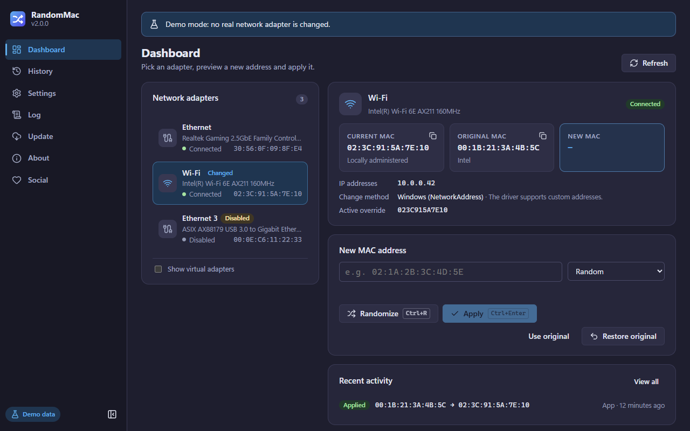
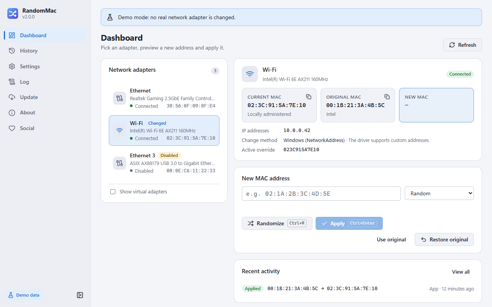
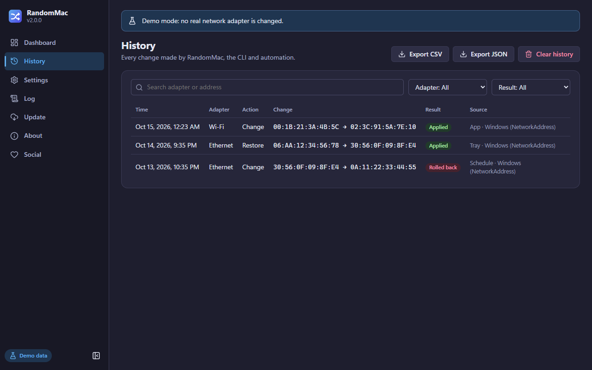
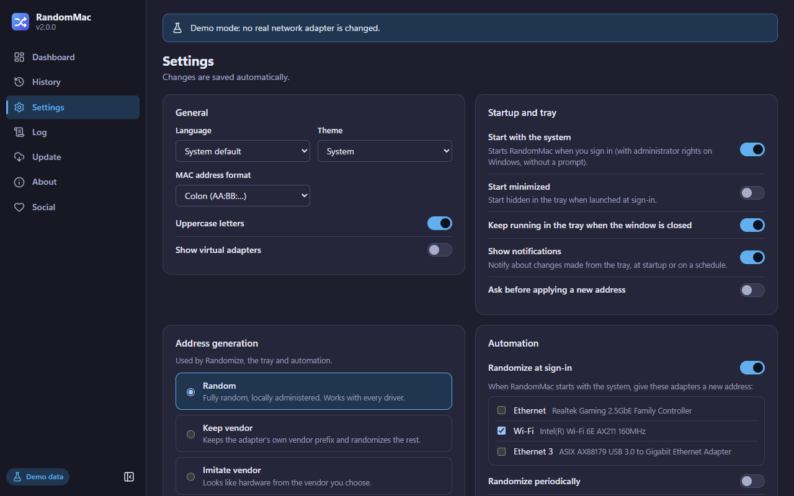

# RandomMac

[](https://github.com/poli0981/randomizerMAC/actions/workflows/ci.yml)
[](https://github.com/poli0981/randomizerMAC/releases/latest)
[](LICENSE)


RandomMac changes the MAC address of your Ethernet and Wi-Fi adapters, so networks you don't control
can't recognize your device by its hardware address. It is a small desktop app for **Windows 10/11
and Linux (Ubuntu, Fedora and other distributions)**, with a command-line tool for scripts.

> **v2.0.0 is a complete rewrite** (Rust + Tauri 2 instead of .NET/WinUI 3): Linux support, a CLI,
> installers that are ~20× smaller, signed automatic updates and many fixes. Coming from 1.x? See
> [Upgrading from 1.x](#upgrading-from-1x). Vietnamese: [README tiếng Việt](docs/i18n/vi/README.md).



<details>
<summary>More screenshots (light theme, history, settings)</summary>





</details>

<sub>Screenshots use the built-in demo data; no real adapter is shown.</sub>

## Features

- **New address in two clicks.** Generate a preview, check its vendor and warnings, then apply.
  Every change is verified; if the driver ignores it, RandomMac rolls it back and tells you why.
- **Generation modes.** Random (locally administered — works with every driver, the default),
  *keep the current vendor*, or *imitate a vendor* (Apple, Samsung, Intel… 59 vendors, 11k prefixes
  from the IEEE registry). Type your own address in any common notation if you prefer.
- **Real original address.** The hardware (permanent) address is read from the driver, so
  **Restore** works at any time — even for changes made by another tool or by RandomMac 1.x.
- **Automation.** Change selected adapters when you sign in, every *N* minutes while the app runs,
  and optionally restore everything when RandomMac exits. **Restore all** is one click away in the
  tray.
- **Blacklist.** Block exact addresses or vendor prefixes, globally or per adapter; import/export.
- **History.** Every change made by the app, the CLI or automation, with search and CSV/JSON export.
- **Command-line tool.** `randommac-cli list | show | random | set | restore | inspect | vendors |
  history`, with `--json` output and stable exit codes.
- **Linux done properly.** NetworkManager (persistent, per connection) or iproute2 (temporary), with
  polkit prompts only when needed — the window itself never runs as root.
- **Comfortable UI.** Light/dark/system theme, English and Vietnamese, keyboard shortcuts, tray
  menu, desktop notifications, live log viewer, diagnostics you can paste into a bug report.
- **Private by design.** No telemetry. The only network request is the update check, which you can
  turn off.

## Download

Get the files from the [latest release](https://github.com/poli0981/randomizerMAC/releases/latest).

| System | File | Notes |
|---|---|---|
| Windows 10/11 (x64) | `RandomMac_<version>_x64-setup.exe` | Recommended. Installs for all users in `Program Files`. |
| Windows 10/11 (x64) | `RandomMac_<version>_x64_en-US.msi` | For managed/silent deployment. |
| Ubuntu 24.04+, Debian 13+ | `RandomMac_<version>_amd64.deb` | Installs `randommac` and `randommac-cli`. |
| Fedora 41+ | `RandomMac-<version>-1.x86_64.rpm` | Installs `randommac` and `randommac-cli`. |
| Other Linux (x86_64) | `RandomMac_<version>_amd64.AppImage` | Portable; updates itself. |
| CLI only | `randommac-cli-<version>-<target>.zip` / `.tar.gz` | Single executable, no GUI. |

### Install

**Windows** — run the setup file. The installer is not code-signed yet, so SmartScreen may say
*"Windows protected your PC"*: choose **More info → Run anyway** after
[verifying the download](#verify-your-download). If the WebView2 runtime is missing (rare on
Windows 10, built into Windows 11), the installer downloads it.

**Ubuntu / Debian**

```bash
sudo apt install ./RandomMac_2.0.0_amd64.deb
```

**Fedora**

```bash
sudo dnf install ./RandomMac-2.0.0-1.x86_64.rpm
```

**AppImage**

```bash
chmod +x RandomMac_2.0.0_amd64.AppImage
./RandomMac_2.0.0_amd64.AppImage
```

### Verify your download

Every release has a `SHA256SUMS.txt` and a [build provenance attestation](https://docs.github.com/actions/security-guides/using-artifact-attestations-to-establish-provenance-for-builds)
proving the files were built by this repository's release workflow.

```bash
sha256sum --ignore-missing -c SHA256SUMS.txt
```

```bash
gh attestation verify RandomMac_2.0.0_x64-setup.exe --repo poli0981/randomizerMAC
```

On Windows without `sha256sum`: `Get-FileHash .\RandomMac_2.0.0_x64-setup.exe -Algorithm SHA256` in
PowerShell, then compare with the line in `SHA256SUMS.txt`.

### Updates

RandomMac checks for updates at most once a day (Settings → Updates → *Check for updates
automatically*; turned off, it never contacts the network on its own). Updates are signed and verified before they are
installed: the Windows installers and the AppImage update in place; for `.deb`/`.rpm` RandomMac
downloads the package and installs it with `apt`/`dnf` after asking for your password.

### System requirements

| | Windows | Linux |
|---|---|---|
| OS | Windows 10 or 11, 64-bit | x86_64 with glibc 2.39+ (Ubuntu 24.04+, Debian 13+, Fedora 41+) |
| Runtime | Microsoft Edge WebView2 (installed if missing) | WebKitGTK 4.1, GTK 3 (pulled in by the packages; bundled in the AppImage) |
| Changing addresses | Administrator rights (one UAC prompt per launch) | NetworkManager, or iproute2 + polkit (`pkexec`) |
| Disk | ~15 MB | ~15 MB (plus WebKitGTK if not installed) |

## Upgrading from 1.x

RandomMac 1.x (WinUI 3/Velopack) cannot update itself to 2.0. Upgrade once by hand:

1. **Install 2.0 first** with `RandomMac_2.0.0_x64-setup.exe`. On first start it imports your 1.x
   settings, history and blacklist from `%LOCALAPPDATA%\RandomMac` and replaces the 1.x startup
   task (which ran an executable from a user-writable folder with administrator rights).
2. **Then uninstall "RANDOM MAC" 1.x** in *Settings → Apps → Installed apps*. Uninstalling 1.x
   deletes `%LOCALAPPDATA%\RandomMac`, so don't do it before step 1 if you want to keep your data.

Addresses applied by 1.x stay active; RandomMac 2.0 can restore them. Settings → Data → *Import
from RandomMac 1.x* repeats the import at any time.

## Using RandomMac

1. Start RandomMac. On Windows, accept the administrator prompt (if you decline, the app opens in
   read-only mode and offers to restart with rights).
2. Pick an adapter on the **Dashboard**. Virtual adapters (VPN, Hyper-V, VirtualBox, Docker…) are
   hidden unless you tick *Show virtual adapters*.
3. **Generate** (`Ctrl+R`) a new address, or type one. RandomMac shows the vendor and warns about
   addresses that are multicast, blacklisted, or not *locally administered* (Wi-Fi on Windows
   accepts only locally administered addresses).
4. **Apply** (`Ctrl+Enter`). The adapter reconnects for a few seconds; RandomMac checks the result
   and rolls back automatically if the driver did not accept the address.
5. **Restore** returns the adapter to its hardware address. The tray menu can also randomize or
   restore the selected adapter and *Restore all adapters*.

| Shortcut | Action |
|---|---|
| `Ctrl+1` … `Ctrl+7` | Dashboard, History, Settings, Log, Update, About, Social |
| `Ctrl+R` | Generate a preview address |
| `Ctrl+Enter` | Apply the preview |
| `F5` | Refresh adapters |
| `Esc` | Close a dialog |

### How it works

- **Windows** — sets the adapter's `NetworkAddress` driver parameter (the same value as
  *Device Manager → Advanced → Network Address*) and restarts the device. The change persists
  across reboots until you restore it.
- **Linux, NetworkManager** — sets `cloned-mac-address` on the active connection profile and
  re-activates it. Persistent for that connection.
- **Linux, iproute2** — `ip link set … address …` through `pkexec`. Temporary: the hardware
  address returns after a reboot or driver reload.

Details: [docs/ARCHITECTURE.md](docs/ARCHITECTURE.md).

## Command-line tool

`randommac-cli` uses the same engine, data and history as the app.

- Windows: `C:\Program Files\RandomMac\randommac-cli.exe` — run it from an **elevated** terminal to
  change addresses.
- Linux (`.deb`/`.rpm`): `/usr/bin/randommac-cli` — no `sudo` needed; NetworkManager or `pkexec`
  ask for authorization when required.
- Anywhere: the standalone `randommac-cli-<version>-<target>` archive from the release page.

```bash
randommac-cli list                          # physical adapters (add --all for virtual ones)
randommac-cli show "Wi-Fi"                  # details, vendor, original address
randommac-cli random "Wi-Fi"                # random locally administered address
randommac-cli random wlp2s0 --mode vendor --vendor apple
randommac-cli set eth0 02:11:22:33:44:55
randommac-cli restore "Wi-Fi"
randommac-cli inspect 3c:22:fb:12:34:56     # vendor, unicast/LAA bits, Wi-Fi readiness
randommac-cli history --limit 10 --json
```

Adapters can be given by name, id or current MAC. Global options: `--json`, `--data-dir <DIR>`,
`--method auto|networkmanager|iproute2` (Linux), `--mock` (demo adapters, nothing is changed).
On Linux, `sudo randommac-cli` keeps its history and original addresses in root's own data
folder, separate from the app's — prefer running it as your user.

| Exit code | Meaning |
|---|---|
| 0 | Success |
| 1 | Other error |
| 2 | Invalid command line |
| 3 | Not enough privileges, or authorization cancelled |
| 4 | Adapter not found / ambiguous |
| 5 | The change failed or was rolled back |
| 6 | Invalid or blacklisted address |

## Where your data lives

| | Windows | Linux |
|---|---|---|
| Settings, blacklist | `%LOCALAPPDATA%\io.github.poli0981.randommac\` | `~/.config/io.github.poli0981.randommac/` |
| History, original addresses | `%LOCALAPPDATA%\io.github.poli0981.randommac\` | `~/.local/share/io.github.poli0981.randommac/` |
| Logs (5 × 2 MB) | `%LOCALAPPDATA%\io.github.poli0981.randommac\logs\` | `~/.local/share/io.github.poli0981.randommac/logs/` |

Files are plain JSON, written atomically. A damaged file is kept as `*.corrupt-<timestamp>` and
replaced with defaults instead of crashing the app. Settings → Data can export everything as one
zip.

## FAQ

**The Wi-Fi address did not change on Windows.**
Windows Wi-Fi drivers accept only *locally administered* addresses — the second hex digit must be
`2`, `6`, `A` or `E` (for example `x2:…`). The default *Random* mode always produces those; the
vendor modes do not. Also check *Settings → Network & internet → Wi-Fi → Random hardware addresses*:
when it is on, Windows replaces the address itself. Some drivers ignore the setting entirely;
RandomMac detects that, restores the previous state and reports *"The driver ignored the new
address"*.

**My connection drops for a moment.**
Expected — the adapter has to restart (Windows) or the connection has to be re-activated (Linux)
for a new address to take effect.

**Which Linux method should I use?**
*Auto* (default) uses NetworkManager for devices it manages with an active connection and iproute2
otherwise. NetworkManager changes are stored in the connection profile and survive reboots;
iproute2 changes are temporary.

**The window is blank on Linux with an NVIDIA GPU.**
RandomMac sets `WEBKIT_DISABLE_DMABUF_RENDERER=1` automatically with the proprietary NVIDIA driver.
If the window is still blank, start it with `WEBKIT_DISABLE_COMPOSITING_MODE=1 randommac`.

**There is no tray icon on GNOME.**
Install the *AppIndicator and KStatusNotifierItem Support* extension (Fedora:
`sudo dnf install gnome-shell-extension-appindicator`, then log out and in). Without a tray,
closing the window quits RandomMac.

**Can I run it as root on Linux?**
The window refuses to run as root (a web engine should never run with root rights). It asks for
authorization only for the change itself. For headless servers use `randommac-cli` (with `sudo` if
NetworkManager/polkit are not available).

**Is changing a MAC address legal?**
In most places, yes — but some networks forbid it in their terms of use. Read the
[Disclaimer](DISCLAIMER.md).

## Build from source

You need Rust (the version in `rust-toolchain.toml` is installed automatically by rustup),
Node.js 24 and the Tauri prerequisites for your OS — see
[docs/DEV_ENVIRONMENT.md](docs/DEV_ENVIRONMENT.md).

```bash
git clone https://github.com/poli0981/randomizerMAC.git
cd randomizerMAC
npm ci
npm run tauri dev
```

```bash
cargo test --workspace
npm test
```

## Project structure

```
crates/randommac-core/   MAC parsing/generation, OUI table, blacklist, history, settings, storage
crates/randommac-net/    Windows and Linux backends, change/verify/rollback orchestration
crates/randommac-cli/    randommac-cli
src-tauri/               desktop app: commands, tray, autostart, elevation, updater, logging
src/                     user interface (Svelte 5 + TypeScript)
scripts/                 version sync, OUI table generator, release helpers
docs/                    documentation
```

## Tech stack

| Part | Technology |
|---|---|
| Core, backends, CLI | Rust 1.98 (edition 2024), clap, serde, tracing |
| Desktop shell | Tauri 2 (WebView2 on Windows, WebKitGTK on Linux) |
| UI | Svelte 5, TypeScript, Vite, Lucide icons |
| Windows APIs | SetupAPI, registry, IP Helper (`windows-sys`) |
| Linux | sysfs, ethtool ioctl, NetworkManager (`nmcli`), iproute2, polkit, D-Bus (`zbus`) |
| Packaging | NSIS, WiX (MSI), deb, rpm, AppImage; signed updater manifest |
| CI/CD | GitHub Actions (Windows + Ubuntu, Fedora package test), cargo-deny, CodeQL |

## Credits

- **Developer**: [poli0981](https://github.com/poli0981)
- **Third-party components**: listed on the About page of the app and in the [EULA](EULA.md).
- Vendor prefixes: [IEEE Registration Authority](https://standards-oui.ieee.org/) public listings.

## AI acknowledgment

This application was built and tested with AI assistance using **Anthropic Claude**.

| Role | Contributor |
|---|---|
| **Developer** | poli0981 (coding, prompting, testing, review, final decisions) |
| **AI Assistant (v1.0.0)** | Claude Opus 4.6 by [Anthropic](https://www.anthropic.com/) via [Claude Code](https://claude.com/claude-code) |
| **AI Assistant (v1.1.x)** | Claude Opus 4.7 by [Anthropic](https://www.anthropic.com/) via [Claude Code](https://claude.com/claude-code) |
| **AI Assistant (v2.0.0)** | Claude Opus 5.5 by [Anthropic](https://www.anthropic.com/) via [Claude Code](https://claude.com/claude-code) — cross-platform rewrite |

**AI was used for:** architecture and code (Rust, Svelte, workflows), debugging, tests,
documentation, Vietnamese translations and GitHub configuration.
**AI was not used for:** final review and approval, testing on physical and virtual machines, and
product decisions — those are done by the developer.

> AI-generated translations are **not guaranteed** to be accurate. See [DISCLAIMER.md](DISCLAIMER.md).

## Legal

- [License (MIT)](LICENSE) · [Disclaimer](DISCLAIMER.md) · [EULA](EULA.md)
- [Security policy](SECURITY.md) · [Code of conduct](CODE_OF_CONDUCT.md) · [Contributing](CONTRIBUTING.md)
- [Changelog](CHANGELOG.md)

> **Important:** changing your MAC address may violate network policies or terms of service. Use
> RandomMac responsibly and in compliance with the law.
