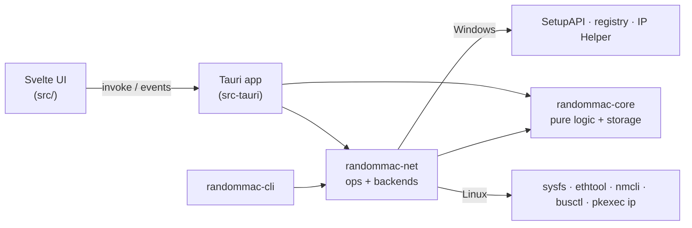

# Architecture

RandomMac 2.x is a Cargo workspace plus a Svelte front end, packaged with Tauri 2.

| Crate / folder | Responsibility | OS-specific? |
|---|---|---|
| `crates/randommac-core` | `MacAddress` (parse/format/bits), CSPRNG generator and modes, OUI table, blacklist, history, settings (+ 1.x migration), `AppState` (original addresses), DNS model, provider catalog, presets and snapshots (`dns/`), timestamps (`timefmt`, on the `time` crate), atomic JSON storage, data paths, operation lock | No — fully unit-tested on every OS |
| `crates/randommac-net` | `NetworkBackend` trait, Windows/Linux/mock backends (MAC and DNS), text parsers for OS tools, `ops` (validate → apply → verify → record), `dns_ops` (the same for DNS), `dns_probe` (latency test) | Backends only; parsers are tested everywhere |
| `crates/randommac-cli` | Command-line front end over `randommac-net::ops` and `dns_ops` | No |
| `src-tauri` | Process setup (elevation, single instance, hardening), Tauri commands, tray, autostart, scheduler, updater, logging, 1.x clean-up | Partly (`platform/`) |
| `src` | UI: pages, stores, i18n, typed API wrapper, dev mock | No |

## Changing an address

All front ends (UI, tray, scheduler, CLI) go through `randommac_net::ops`:

1. **Resolve** the adapter by id, name or MAC; take the cross-process **operation lock**
   (`operation.lock`, `File::try_lock`, 15 s timeout) so only one change runs at a time — also
   between the app and the CLI. Inside the app, `ops_runner` additionally serializes the UI, tray,
   scheduler and startup automation.
2. **Validate**: unicast and not all-zero, never one of the reserved addresses (`00…`, `FF…`,
   `AA:AA:AA:AA:AA:AA`), not matched by a blacklist rule (global or for this adapter) unless the
   caller explicitly ignores the user's rules.
3. **Record the original** configuration in `state.json` before the change: the adapter's address
   the first time it is changed and, on Linux, the `cloned-mac-address` of each NetworkManager
   profile the first time that profile is involved (the adapter may roam between connections).
   The record is dropped again only when the backend proves nothing changed.
4. **Apply** with the backend, reporting stages (`Preparing → Writing → Restarting → Verifying`) to
   the UI as `op:progress` events.
5. **Verify** by polling the live address (up to 20 s). If it does not match, the backend
   **rolls back** to the previous configuration and the result is `RolledBack` with a reason
   (e.g. `DRIVER_REJECTED`).
6. **Record history** (source: UI, tray, startup, schedule, exit, CLI) and emit change events.

Restore follows the same path and removes RandomMac's override instead of writing a new one.

## Windows backend (`windows.rs`)

- **Enumeration**: SetupAPI over the `Net` device class (`DIGCF_PRESENT`), so disabled adapters are
  listed too. The adapter id is the **device instance id** (identical to the PnP id used by 1.x,
  which lets 1.x settings migrate). Each device's driver key is opened with
  `SetupDiOpenDevRegKey(DIREG_DRV)` — never by searching descriptions — which fixes 1.x writing to
  the wrong adapter.
- **Classification** (`win_classify.rs`): interface type (71 = Wi-Fi, 6 = Ethernet), physical-media
  type, `Characteristics` (`NCF_VIRTUAL`, `NCF_PHYSICAL`), known virtual drivers.
- **Addresses**: `GetIfTable2`/`GetIfEntry2` by LUID give the current address and the
  `PermanentPhysicalAddress`; `GetAdaptersAddresses` gives IPs and the friendly name.
- **Apply**: write the `NetworkAddress` `REG_SZ` (12 hex digits) in the driver key, then restart
  the device with `DIF_PROPERTYCHANGE`/`DICS_PROPCHANGE` (`DICS_FLAG_CONFIGSPECIFIC`) on a
  watchdog thread (90 s). If the class installer asks for a reboot, the result says so.
- **Rollback/restore**: put back the previous `NetworkAddress` value (rollback) or delete it
  (restore), then restart again.
- **Wi-Fi**: Windows Wi-Fi drivers only accept locally administered addresses (`x2/x6/xA/xE`);
  the generator's default mode guarantees that and the UI warns otherwise.

## Linux backend (`linux.rs`, `linux_parse.rs`)

- **Enumeration**: `/sys/class/net` (type, `wireless/`, `device` link for physical vs virtual,
  driver, operstate), the udev database for model/vendor names, `getifaddrs` for IPs.
- **Hardware address**: `ETHTOOL_GPERMADDR` ioctl (works unprivileged; all-zero → unknown).
- **NetworkManager method** (persistent): find the active connection's UUID with `nmcli`, set
  `802-3-ethernet.cloned-mac-address` / `802-11-wireless.cloned-mac-address`, re-activate the
  connection. Runs as the user; polkit asks only if the user may not modify the profile. Restore
  puts back the recorded value of every profile RandomMac changed (inactive ones without
  activating them); for the active one it sets `permanent`, re-activates, then restores the value.
  NetworkManager's own `random`/`stable` policies are never treated as RandomMac changes.
- **iproute2 method** (temporary): `pkexec <ip> -force -batch -` with `down / address / up`
  commands on stdin, an empty environment and a fixed `PATH`; interface names are validated so no
  second command can be smuggled in. `pkexec` exit 126 = dialog dismissed, 127 = not authorized
  or polkit unavailable.
- **Auto** chooses NetworkManager when the device is managed and has an active connection,
  otherwise iproute2.

## DNS settings

DNS changes take their own path, `randommac_net::dns_ops`, under the same operation lock as MAC
changes. Every front end (UI, tray, CLI) goes through it:

1. **Check the adapter**: `dns_capabilities` says whether its DNS settings can be changed now and
   which IP versions and kinds of encryption it supports, each with a reason when not (Windows
   version, administrator rights, NetworkManager, the IP version turned off…).
2. **Validate and resolve** the request (`randommac_core::dns`): a provider variant from
   `catalog.json`, a preset, the local resolver (`127.0.0.1` / `::1`) or custom servers (at most
   two per IP version; no unspecified, multicast or link-local addresses; DoH templates
   `https://host/path`, DoT host names). The encryption choice is resolved against what the
   adapter supports: *preferred* = DoH, else DoT, else plain DNS.
3. **Snapshot**: the adapter's current settings, in the backend's own terms, go to
   `dns-state.json` — only the first time. Later changes never replace that record, so *Restore
   original* goes back to the settings from before RandomMac's first DNS change. When the change
   does not happen, the record is dropped again; when the adapter ends up back on its original
   settings, there is nothing left to restore.
4. **Apply** with the backend (`Preparing → Writing → Restarting → Verifying`).
5. **Read back** what the system stored. If it is not what was written, the backend **rolls back**
   to the snapshot (`RolledBack`, `DNS_NOT_APPLIED`). Then it waits (up to 10 s) until the adapter
   uses the first requested server, else the result is `Unverified` (`DNS_NOT_ACTIVE`).
6. **Record history**: `kind: "dns"` with the previous, requested and observed settings, the
   matching provider/preset label and warning codes (`DNS_IPV6_SKIPPED`, `DNS_PROFILE_OVERRIDE`,
   `DNS_CACHE_NOT_FLUSHED`…).

Restore puts the snapshot back and clears the record. "Every connected adapter" (`apply_dns_all`,
the CLI's `--all`) means every connected physical adapter that can change DNS, each with its own
result.

**Windows** (`windows_dns.rs`; the calls and checks as plain data in `win_dns.rs`, tested on every
OS):

- `GetInterfaceDnsSettings`, `SetInterfaceDnsSettings` and `FreeInterfaceDnsSettings` (IP Helper,
  Windows 10 2004+) are looked up at run time (`LoadLibraryExW` restricted to System32 +
  `GetProcAddress`): linking them would keep the binaries from starting on older Windows 10 builds.
- One call per address family. DNS over HTTPS (`DNS_INTERFACE_SETTINGS3`, Windows 11 and Windows
  Server 2022+) is configured per server address: a template for each server, optionally with
  fallback to UDP. Whenever the system supports DoH, the DoH settings are written too (empty for
  plain DNS), because Windows otherwise keeps old DoH settings per server address.
- Snapshots keep the servers and DoH entries exactly as read, flags included — Windows can report
  flags RandomMac never sets, such as `0x11` (`ENABLE_AUTO | ENABLE_DDR`) — and restore writes them
  back verbatim. The "profile" servers that only the Settings app writes are left alone; when
  present they take precedence, and the result warns (`DNS_PROFILE_OVERRIDE`).
- Windows may list an adapter's IPv6 servers before its IPv4 ones, so "in use" means the requested
  server is listed anywhere. When IPv6 is unbound from the adapter (VPN clients do that against
  leaks), its settings are still written if Windows accepts them; a refusal skips IPv6
  (`DNS_IPV6_SKIPPED`).
- Afterwards the DNS client cache is flushed with `ipconfig /flushdns`.

**Linux** (`linux_dns.rs`; nmcli arguments and output parsing as plain data in `nm_dns.rs`):

- The device's active NetworkManager profile: `ipv4.dns`, `ipv6.dns`, their `ignore-auto-dns` and
  `connection.dns-over-tls`, changed with `nmcli connection modify` and applied with
  `nmcli device reapply` (no reconnect). If `reapply` fails, or the new servers are not in use
  afterwards (DHCPv6 servers can stay), the connection is brought up again once.
- DNS over TLS (`#host` suffixes on the servers; `opportunistic` with fallback, `yes` without)
  only when NetworkManager hands DNS to systemd-resolved: its `DnsManager.Mode` is read over D-Bus
  with `busctl`. NetworkManager has no DoH client. A family whose method takes no DNS servers
  (`disabled`, `link-local`, IPv6 `ignore`) is skipped with a warning.
- Originals are recorded per connection UUID (`nmProfiles`), like the MAC originals, because the
  adapter may roam between connections; restore puts back every recorded profile. The resolver
  cache is left alone (flushing it would ask for authorization).
- CI runs this code against `tests/fake-nmcli.sh` and `tests/fake-busctl.sh`.

**Latency test** (`dns_probe.rs`, wire format in `randommac_core::dns::wire`): a UDP query for the
root zone's NS records (`.` NS, recursion desired) to port 53 of each server — one untimed warm-up
query, then 3 timed ones by default (1.5 s timeout each) — reporting median/min/max, timeouts,
refusals and unreachable servers. Up to 8 servers are probed at a time (16 at most) on scoped
threads, each result is reported as soon as it is known, and a cancel flag stops the test within a
fraction of a second. Nothing else is sent, and only when the user starts it. The same probe with
one attempt is the reachability check the CLI and the UI run before switching to **plain** DNS;
encrypted DNS uses other ports, which may be open where port 53 is not.

**App and UI**: the Tauri commands `dns_catalog`, `dns_view`, `dns_apply`, `dns_apply_all`,
`dns_restore`, `dns_latency_test` (results also streamed as `dns:latency` events) and
`dns_latency_cancel`. `ops_runner` runs DNS changes like MAC changes; its `app:busy` and
`op:progress` events carry `kind: "mac" | "dns"` so each page shows only its own steps, and
`dns:changed` follows a change. DNS changes are not tracked for *restore on exit*. The tray's DNS
submenu is built by `tray_menu.rs` (plain data, tested): every provider's default variant, the
presets, *Automatic* and *Restore original DNS*, encrypted when the DNS page's preference says so.
Presets (up to 20), the encryption preference and the fallback switch are part of `settings.json`
(`dns`); a settings reset keeps the presets.

## The desktop app (`src-tauri`)

Startup (`lib.rs::main_entry`):

1. **Hardening** (Windows): `SetDefaultDllDirectories`, strip `WEBVIEW2_*` variables (they could
   inject browser arguments into an elevated process).
2. Handle `--version`, `--help` and the installer hooks `--cleanup-legacy` / `--cleanup-uninstall`.
3. **Single instance**: a named event (Windows, with a security descriptor that lets a
   non-elevated second launch wake the elevated first one) or `tauri-plugin-single-instance`
   (Linux). A second launch only shows the existing window — no UAC prompt.
4. **Elevation** (Windows release builds): the manifest is `asInvoker`; the app relaunches itself
   with `ShellExecuteExW("runas")`. Declined → read-only mode. The autostart task already runs
   elevated, so sign-in starts without a prompt. On Linux the GUI refuses to run as root.
5. `run_app`: data paths, logging, storage, 1.x import, autostart repair, window (created in code
   so the WebView2 data folder can be separated for elevated and normal runs), tray, scheduler,
   update check (at most once per 24 h, only if enabled).

Shutdown (`lib.rs::request_quit`): stop the scheduler and refuse new changes, wait (up to 150 s)
for a running change to verify or roll back, run *restore on exit* for the adapters changed in this
session if enabled, then exit.

Other modules:

| Module | Purpose |
|---|---|
| `commands.rs` | ~40 commands; DTOs are camelCase, errors are `ApiError { code, message }` |
| `ops_runner.rs` | Runs each MAC or DNS change in its own task (cancelling the caller never stops it half-way), off the UI thread; emits progress and busy events (with `kind`), sends OS notifications, restore-all, startup automation |
| `scheduler.rs` | Periodic change of the selected adapters |
| `tray.rs` | Tray menu (localized by `i18n.rs`, rebuilt when the language, the selected adapter or the DNS presets change); on Linux only when a StatusNotifierWatcher exists (re-checked for 30 s after start) |
| `tray_menu.rs` | The tray's DNS submenu as plain data: items, what each item requests, names used in notifications |
| `autostart.rs` | Windows: Task Scheduler XML task `RandomMac-Autostart-<SID>` via `schtasks.exe`; Linux: XDG `.desktop` entry |
| `legacy.rs` | Imports 1.x data, removes the 1.x `\RandomMac` logon task when it points to 1.x |
| `updater.rs` | `tauri-plugin-updater`; `.deb`/`.rpm` installed with `pkexec apt-get/dnf install` |
| `logging.rs` | `tracing` → rotating files (5 × 2 MB) + in-memory ring buffer for the Log page |
| `links.rs` | Exact host/path allowlist; the normalized URL is opened, on Windows through the non-elevated shell |

## User interface (`src/`)

- Svelte 5 runes; one app store (`lib/stores/app.svelte.ts`) holds adapters, settings, history and
  operation state; `lib/api.ts` is the only place that calls `invoke`.
- Logic lives in tested `.ts` modules rather than in components: `lib/dns.ts` (the DNS page:
  checks that mirror the Rust validation, requests, encryption choices and why they are
  unavailable, the latency table, presets), `lib/history.ts` (MAC/DNS filtering, the change
  column), `lib/nav.ts` (page order, which is also the `Ctrl+1` … `Ctrl+8` order).
- i18n: `en.ts` is the source of truth, `vi.ts` is typed against it; tests check keys and
  placeholders.
- Release notes are rendered with `marked` and sanitized with DOMPurify.
- `lib/devmock.ts` replaces the backend when the UI runs in a normal browser (`npm run dev`).

## Data

| File | Content |
|---|---|
| `settings.json` | Preferences, automation, Linux method, history policy, DNS preferences and presets (`schemaVersion` 3) |
| `blacklist.json` | User rules (address or prefix, optional adapter) |
| `history.json` | MAC and DNS changes (`kind`, absent for MAC entries; default: 500 entries, 90 days) |
| `state.json` | Original MAC configuration per changed adapter |
| `dns-state.json` | Original DNS settings per adapter (NetworkManager: per connection UUID), kept apart from `state.json` so a problem with one never costs the other |
| `operation.lock` | Cross-process change lock |
| `logs/` | `randommac.log` + rotated files |

Timestamps are RFC 3339 in UTC with `Z` (`randommac_core::timefmt`, on the `time` crate), the same
text 2.0.x wrote with chrono, so files load in both directions. Writes go to a temporary file, are
fsynced and renamed. Unreadable files are quarantined as
`<name>.corrupt-<timestamp>` (three kept) and defaults are used. Files above 8 MiB are refused.
On Windows the data folder is refused if it is a junction or symbolic link.

## Security model

- The UI can call only the app's own commands (generated permission set) plus the few plugin APIs
  it needs; strict CSP, `freezePrototype`, navigation restricted to the app origin.
- External processes are started by absolute path with a fixed `PATH`; arguments are never passed
  through a shell. Their output is decoded as UTF-8, or on Windows in the console's OEM code page.
- Windows: installed per machine (`Program Files`, not user-writable). System programs
  (`schtasks.exe`, `reg.exe`, `ipconfig.exe`, `explorer.exe`) and the elevated process's private
  temp folder (`<Windows>\Temp\RandomMac-<id>`, SYSTEM + Administrators only) are located through
  `GetSystemWindowsDirectoryW`, never through `%SystemRoot%`, which an unprivileged process could
  change in the environment the elevated app inherits.
- The latency test and the reachability check send only a fixed query for the root zone's NS
  records, and only when the user runs a test or applies plain DNS servers.
- Updates: `latest.json` and every package are signed with the updater key (minisign); the public
  key is embedded in the app. Release assets have SHA-256 sums and build-provenance attestations.

## Release pipeline

`ci.yml` (pull requests and `master`): frontend checks, Rust fmt/clippy/tests on Windows and Ubuntu,
real MAC and DNS changes on a Linux dummy interface (iproute2, and NetworkManager through stand-in
`nmcli`/`busctl`), real DNS changes on the Windows runner's adapter (plain DNS, DoH, restore,
automatic), package builds with install/uninstall and GUI smoke tests (NSIS, MSI, deb, rpm in
Fedora), `cargo-deny`, `npm audit`, the npm license check, dependency review (pull requests) and
the SonarQube Cloud analysis. `qodana.yml` runs JetBrains Qodana on the Rust workspace and on the
TypeScript/Svelte UI, with a quality gate of zero problems.

`release.yml` (tag `vX.Y.Z`): version check → build + sign on Windows and Ubuntu → verify the asset
set and every updater signature against the public key in `tauri.conf.json` → `latest.json`
(platform keys `windows-x86_64[-nsis|-msi]`, `linux-x86_64[-appimage|-deb|-rpm]`) →
`SHA256SUMS.txt` → provenance attestation → publish → dispatch the Discord and Discussions
workflows (a release published with `GITHUB_TOKEN` does not trigger them by itself). Re-runs can
complete a draft release but never overwrite a published one.
