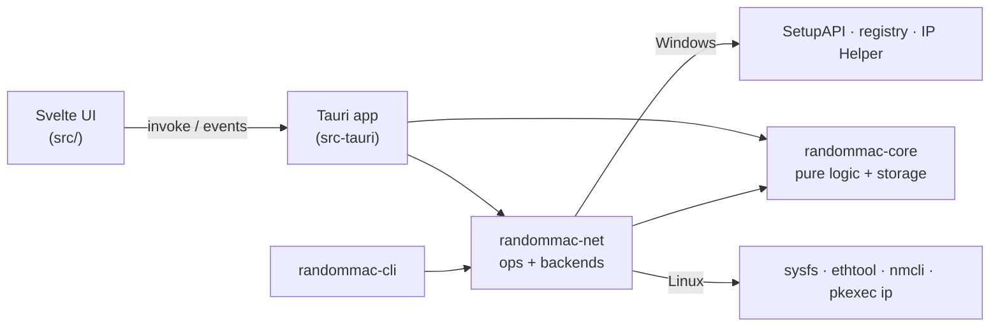

# Architecture

RandomMac 2.x is a Cargo workspace plus a Svelte front end, packaged with Tauri 2.

| Crate / folder | Responsibility | OS-specific? |
|---|---|---|
| `crates/randommac-core` | `MacAddress` (parse/format/bits), CSPRNG generator and modes, OUI table, blacklist, history, settings (+ 1.x migration), `AppState` (original addresses), atomic JSON storage, data paths, operation lock | No — fully unit-tested on every OS |
| `crates/randommac-net` | `NetworkBackend` trait, Windows/Linux/mock backends, text parsers for OS tools, `ops` (validate → apply → verify → record) | Backends only; parsers are tested everywhere |
| `crates/randommac-cli` | Command-line front end over `randommac-net::ops` | No |
| `src-tauri` | Process setup (elevation, single instance, hardening), Tauri commands, tray, autostart, scheduler, updater, logging, 1.x clean-up | Partly (`platform/`) |
| `src` | UI: pages, stores, i18n, typed API wrapper, dev mock | No |

## Changing an address

All front ends (UI, tray, scheduler, CLI) go through `randommac_net::ops`:

1. **Resolve** the adapter by id, name or MAC; take the cross-process **operation lock**
   (`operation.lock`, `File::try_lock`, 15 s timeout) so only one change runs at a time — also
   between the app and the CLI. Inside the app, `ops_runner` additionally serializes the UI, tray,
   scheduler and startup automation.
2. **Validate**: unicast and not all-zero, never one of the reserved addresses (`00…`, `FF…`,
   `AA:AA:AA:AA:AA:AA`), not matched by a blacklist rule (global or for this adapter) unless the
   caller explicitly ignores the user's rules.
3. **Record the original** configuration in `state.json` before the change: the adapter's address
   the first time it is changed and, on Linux, the `cloned-mac-address` of each NetworkManager
   profile the first time that profile is involved (the adapter may roam between connections).
   The record is dropped again only when the backend proves nothing changed.
4. **Apply** with the backend, reporting stages (`Preparing → Writing → Restarting → Verifying`) to
   the UI as `op:progress` events.
5. **Verify** by polling the live address (up to 20 s). If it does not match, the backend
   **rolls back** to the previous configuration and the result is `RolledBack` with a reason
   (e.g. `DRIVER_REJECTED`).
6. **Record history** (source: UI, tray, startup, schedule, exit, CLI) and emit change events.

Restore follows the same path and removes RandomMac's override instead of writing a new one.

## Windows backend (`windows.rs`)

- **Enumeration**: SetupAPI over the `Net` device class (`DIGCF_PRESENT`), so disabled adapters are
  listed too. The adapter id is the **device instance id** (identical to the PnP id used by 1.x,
  which lets 1.x settings migrate). Each device's driver key is opened with
  `SetupDiOpenDevRegKey(DIREG_DRV)` — never by searching descriptions — which fixes 1.x writing to
  the wrong adapter.
- **Classification** (`win_classify.rs`): interface type (71 = Wi-Fi, 6 = Ethernet), physical-media
  type, `Characteristics` (`NCF_VIRTUAL`, `NCF_PHYSICAL`), known virtual drivers.
- **Addresses**: `GetIfTable2`/`GetIfEntry2` by LUID give the current address and the
  `PermanentPhysicalAddress`; `GetAdaptersAddresses` gives IPs and the friendly name.
- **Apply**: write the `NetworkAddress` `REG_SZ` (12 hex digits) in the driver key, then restart
  the device with `DIF_PROPERTYCHANGE`/`DICS_PROPCHANGE` (`DICS_FLAG_CONFIGSPECIFIC`) on a
  watchdog thread (90 s). If the class installer asks for a reboot, the result says so.
- **Rollback/restore**: put back the previous `NetworkAddress` value (rollback) or delete it
  (restore), then restart again.
- **Wi-Fi**: Windows Wi-Fi drivers only accept locally administered addresses (`x2/x6/xA/xE`);
  the generator's default mode guarantees that and the UI warns otherwise.

## Linux backend (`linux.rs`, `linux_parse.rs`)

- **Enumeration**: `/sys/class/net` (type, `wireless/`, `device` link for physical vs virtual,
  driver, operstate), the udev database for model/vendor names, `getifaddrs` for IPs.
- **Hardware address**: `ETHTOOL_GPERMADDR` ioctl (works unprivileged; all-zero → unknown).
- **NetworkManager method** (persistent): find the active connection's UUID with `nmcli`, set
  `802-3-ethernet.cloned-mac-address` / `802-11-wireless.cloned-mac-address`, re-activate the
  connection. Runs as the user; polkit asks only if the user may not modify the profile. Restore
  puts back the recorded value of every profile RandomMac changed (inactive ones without
  activating them); for the active one it sets `permanent`, re-activates, then restores the value.
  NetworkManager's own `random`/`stable` policies are never treated as RandomMac changes.
- **iproute2 method** (temporary): `pkexec <ip> -force -batch -` with `down / address / up`
  commands on stdin, an empty environment and a fixed `PATH`; interface names are validated so no
  second command can be smuggled in. `pkexec` exit 126 = dialog dismissed, 127 = not authorized
  or polkit unavailable.
- **Auto** chooses NetworkManager when the device is managed and has an active connection,
  otherwise iproute2.

## The desktop app (`src-tauri`)

Startup (`lib.rs::main_entry`):

1. **Hardening** (Windows): `SetDefaultDllDirectories`, strip `WEBVIEW2_*` variables (they could
   inject browser arguments into an elevated process).
2. Handle `--version`, `--help` and the installer hooks `--cleanup-legacy` / `--cleanup-uninstall`.
3. **Single instance**: a named event (Windows, with a security descriptor that lets a
   non-elevated second launch wake the elevated first one) or `tauri-plugin-single-instance`
   (Linux). A second launch only shows the existing window — no UAC prompt.
4. **Elevation** (Windows release builds): the manifest is `asInvoker`; the app relaunches itself
   with `ShellExecuteExW("runas")`. Declined → read-only mode. The autostart task already runs
   elevated, so sign-in starts without a prompt. On Linux the GUI refuses to run as root.
5. `run_app`: data paths, logging, storage, 1.x import, autostart repair, window (created in code
   so the WebView2 data folder can be separated for elevated and normal runs), tray, scheduler,
   update check (at most once per 24 h, only if enabled).

Shutdown (`lib.rs::request_quit`): stop the scheduler and refuse new changes, wait (up to 150 s)
for a running change to verify or roll back, run *restore on exit* for the adapters changed in this
session if enabled, then exit.

Other modules:

| Module | Purpose |
|---|---|
| `commands.rs` | ~35 commands; DTOs are camelCase, errors are `ApiError { code, message }` |
| `ops_runner.rs` | Runs each change in its own task (cancelling the caller never stops it half-way), off the UI thread; emits progress and busy events, sends OS notifications, restore-all, startup automation |
| `scheduler.rs` | Periodic change of the selected adapters |
| `tray.rs` | Tray menu (localized by `i18n.rs`); on Linux only when a StatusNotifierWatcher exists (re-checked for 30 s after start) |
| `autostart.rs` | Windows: Task Scheduler XML task `RandomMac-Autostart-<SID>` via `schtasks.exe`; Linux: XDG `.desktop` entry |
| `legacy.rs` | Imports 1.x data, removes the 1.x `\RandomMac` logon task when it points to 1.x |
| `updater.rs` | `tauri-plugin-updater`; `.deb`/`.rpm` installed with `pkexec apt-get/dnf install` |
| `logging.rs` | `tracing` → rotating files (5 × 2 MB) + in-memory ring buffer for the Log page |
| `links.rs` | Exact host/path allowlist; the normalized URL is opened, on Windows through the non-elevated shell |

## User interface (`src/`)

- Svelte 5 runes; one app store (`lib/stores/app.svelte.ts`) holds adapters, settings, history and
  operation state; `lib/api.ts` is the only place that calls `invoke`.
- i18n: `en.ts` is the source of truth, `vi.ts` is typed against it; tests check keys and
  placeholders.
- Release notes are rendered with `marked` and sanitized with DOMPurify.
- `lib/devmock.ts` replaces the backend when the UI runs in a normal browser (`npm run dev`).

## Data

| File | Content |
|---|---|
| `settings.json` | Preferences, automation, Linux method, history policy (`schemaVersion` 2) |
| `blacklist.json` | User rules (address or prefix, optional adapter) |
| `history.json` | Changes (default: 500 entries, 90 days) |
| `state.json` | Original configuration per changed adapter |
| `operation.lock` | Cross-process change lock |
| `logs/` | `randommac.log` + rotated files |

Writes go to a temporary file, are fsynced and renamed. Unreadable files are quarantined as
`<name>.corrupt-<timestamp>` (three kept) and defaults are used. Files above 8 MiB are refused.
On Windows the data folder is refused if it is a junction or symbolic link.

## Security model

- The UI can call only the app's own commands (generated permission set) plus the few plugin APIs
  it needs; strict CSP, `freezePrototype`, navigation restricted to the app origin.
- External processes are started by absolute path with a fixed `PATH`; arguments are never passed
  through a shell. Their output is decoded as UTF-8, or on Windows in the console's OEM code page.
- Windows: installed per machine (`Program Files`, not user-writable). System programs
  (`schtasks.exe`, `reg.exe`, `explorer.exe`) and the elevated process's private temp folder
  (`<Windows>\Temp\RandomMac-<id>`, SYSTEM + Administrators only) are located through
  `GetSystemWindowsDirectoryW`, never through `%SystemRoot%`, which an unprivileged process could
  change in the environment the elevated app inherits.
- Updates: `latest.json` and every package are signed with the updater key (minisign); the public
  key is embedded in the app. Release assets have SHA-256 sums and build-provenance attestations.

## Release pipeline

`ci.yml` (pull requests and `master`): frontend checks, Rust fmt/clippy/tests on Windows and Ubuntu,
a real change on a Linux dummy interface, package builds with install/uninstall and GUI smoke
tests (NSIS, MSI, deb, rpm in Fedora), `cargo-deny` and `npm audit`.

`release.yml` (tag `vX.Y.Z`): version check → build + sign on Windows and Ubuntu → verify the asset
set and every updater signature against the public key in `tauri.conf.json` → `latest.json`
(platform keys `windows-x86_64[-nsis|-msi]`, `linux-x86_64[-appimage|-deb|-rpm]`) →
`SHA256SUMS.txt` → provenance attestation → publish → dispatch the Discord and Discussions
workflows (a release published with `GITHUB_TOKEN` does not trigger them by itself). Re-runs can
complete a draft release but never overwrite a published one.
