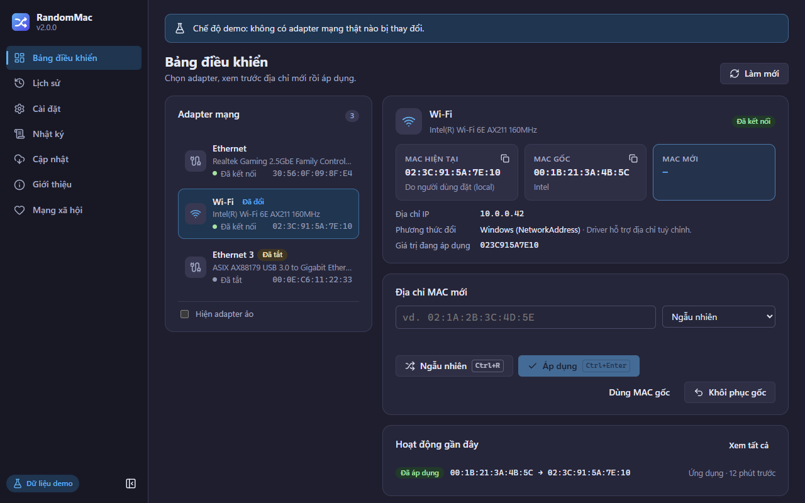
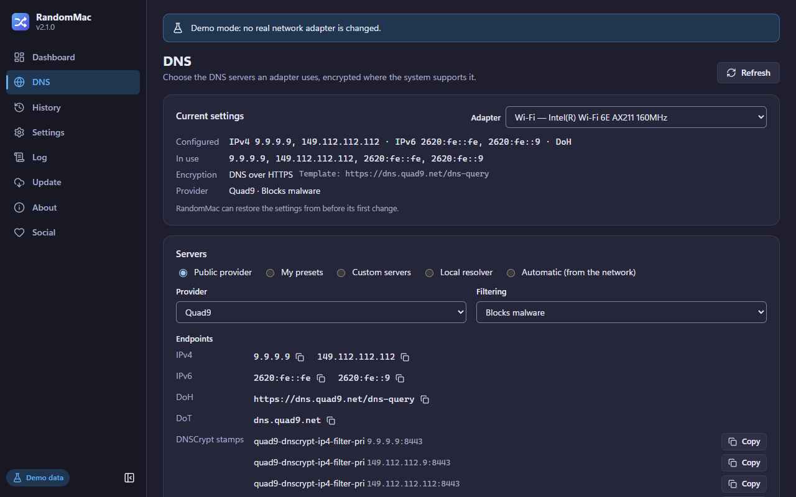

# RandomMac

[](https://github.com/poli0981/randomizerMAC/actions/workflows/ci.yml)
[](https://sonarcloud.io/summary/overall?id=poli0981_randomizerMAC)
[](https://sonarcloud.io/component_measures?id=poli0981_randomizerMAC&metric=coverage)
[](https://github.com/poli0981/randomizerMAC/releases/latest)
[](#trạng-thái-dự-án)
[](../../../LICENSE)

RandomMac đổi địa chỉ MAC của card Ethernet và Wi-Fi để các mạng bạn không kiểm soát không thể nhận
ra thiết bị qua địa chỉ phần cứng. App cũng đặt được máy chủ DNS cho từng adapter — nhà cung cấp
công cộng (có hoặc không có bộ lọc) hay máy chủ của riêng bạn — có mã hoá khi hệ thống hỗ trợ. Đây
là ứng dụng desktop nhỏ gọn cho **Windows 10/11 và Linux (Ubuntu, Fedora và các bản phân phối
khác)**, kèm công cụ dòng lệnh để viết script.

> **v2.0.0 được viết lại hoàn toàn** (Rust + Tauri 2 thay cho .NET/WinUI 3): hỗ trợ Linux, có CLI,
> bộ cài nhỏ hơn ~20 lần, cập nhật tự động có chữ ký và rất nhiều bản sửa lỗi. Đang dùng 1.x? Xem
> [Nâng cấp từ 1.x](#nâng-cấp-từ-1x). English: [README](../../../README.md).

> Bản dịch tiếng Việt do AI tạo và có thể chưa chính xác tuyệt đối — bản tiếng Anh là bản gốc.



<sub>Ảnh chụp dùng dữ liệu demo có sẵn trong app; không hiển thị adapter thật.</sub>

## Trạng thái dự án

Từ bản 2.1.0 (tháng 11/2026), RandomMac chuyển sang **chế độ bảo trì**: đây là bản phát hành tính
năng cuối cùng. Dự án vẫn được bảo trì và vẫn nhận các thay đổi sau:

- cập nhật thư viện phụ thuộc;
- bản vá bảo mật: thư viện phụ thuộc có CVE mức cao hoặc nghiêm trọng (high/critical) và lỗi bảo
  mật nghiêm trọng trong runtime như Node.js — còn tính năng mới thì chỉ khi thật sự cần thiết;
- nâng cấp phiên bản lớn của ngôn ngữ, runtime hoặc framework (ví dụ Node.js 24 → 26 hay TypeScript
  6 → 7);
- sửa lỗi, cải thiện UI/UX và trợ năng;
- sửa ngôn ngữ: cách diễn đạt không hợp với một nền văn hoá hay phương ngữ vùng miền, và lỗi chính tả
  khiến nội dung bị hiểu sai.

Yêu cầu tính năng và pull request `feat:` từ người đóng góp bên ngoài sẽ tự động bị đóng với nhãn
`out-of-scope`. Ý tưởng vẫn luôn được chào đón tại
[Discussions → Ideas](https://github.com/poli0981/randomizerMAC/discussions/categories/ideas).
Chi tiết: [CONTRIBUTING.md → Maintenance mode](../../../CONTRIBUTING.md#maintenance-mode).

## Tính năng

- **Đổi địa chỉ trong hai bước.** Tạo địa chỉ xem trước, kiểm tra hãng và cảnh báo, rồi áp dụng.
  Mọi thay đổi đều được xác minh; nếu driver bỏ qua, RandomMac tự hoàn tác và cho biết lý do.
- **Chế độ tạo MAC.** Ngẫu nhiên (địa chỉ quản trị cục bộ — mọi driver đều nhận, mặc định), *giữ hãng
  hiện tại*, hoặc *giả lập hãng* (Apple, Samsung, Intel… 59 hãng, 11 nghìn tiền tố từ IEEE). Bạn cũng
  có thể tự nhập địa chỉ theo mọi định dạng phổ biến.
- **Địa chỉ gốc thật.** Địa chỉ phần cứng (vĩnh viễn) được đọc từ driver nên **Khôi phục** dùng được
  bất cứ lúc nào — kể cả với địa chỉ do công cụ khác hoặc RandomMac 1.x đặt. Các tính năng riêng tư
  của hệ điều hành (*random hardware addresses* của Windows, chế độ `random`/`stable` của
  NetworkManager) được giữ nguyên.
- **Tự động hoá.** Đổi MAC các adapter đã chọn khi đăng nhập, mỗi *N* phút khi app đang chạy, và
  (tuỳ chọn) khôi phục tất cả khi thoát. **Khôi phục tất cả** có ngay trong khay hệ thống.
- **Danh sách chặn.** Chặn địa chỉ cụ thể hoặc tiền tố hãng, cho mọi adapter hoặc từng adapter;
  nhập/xuất được.
- **Máy chủ DNS cho từng adapter.** Các nhà cung cấp có sẵn kèm các mức lọc — Cloudflare, Google,
  Quad9, AdGuard, CleanBrowsing, Control D, DNS4EU, DNS.SB và Cisco OpenDNS — hoặc máy chủ của riêng
  bạn, cho cả IPv4 và IPv6. Có mã hoá khi hệ thống hỗ trợ: DNS over HTTPS trên Windows 11 và Windows
  Server 2022 trở lên, DNS over TLS trên Linux khi NetworkManager dùng systemd-resolved. Stamp
  DNSCrypt để sao chép vào một client như dnscrypt-proxy, cùng lựa chọn *trình phân giải cục bộ*
  (`127.0.0.1` / `::1`) để adapter dùng client đó. Có đo độ trễ, preset, *Khôi phục ban đầu* và menu
  DNS trong khay hệ thống. Mọi thay đổi đều được xác minh, tự hoàn tác nếu hệ thống không giữ, và
  được ghi vào lịch sử.
- **Lịch sử.** Mọi thay đổi từ app, CLI hay tự động hoá (địa chỉ MAC và DNS), có tìm kiếm, lọc theo
  MAC/DNS và xuất CSV/JSON.
- **Công cụ dòng lệnh.** `randommac-cli list | show | random | set | restore | inspect | vendors |
  dns | history`, có `--json` và mã thoát ổn định.
- **Linux đúng cách.** NetworkManager (bền vững, theo từng kết nối) hoặc iproute2 (tạm thời), chỉ hỏi
  quyền polkit khi cần — bản thân cửa sổ không bao giờ chạy với quyền root.
- **Giao diện dễ dùng.** Giao diện sáng/tối/theo hệ thống, tiếng Anh và tiếng Việt, phím tắt, menu
  khay, thông báo hệ thống, xem log trực tiếp, thông tin chẩn đoán để dán vào báo lỗi.
- **Riêng tư.** Không thu thập dữ liệu. Yêu cầu mạng tự động duy nhất là kiểm tra cập nhật, có thể
  tắt. Truy vấn DNS thử chỉ được gửi khi bạn chạy đo độ trễ hoặc chuyển sang máy chủ DNS thường
  (không mã hoá).

## Tải về

Tải từ [bản phát hành mới nhất](https://github.com/poli0981/randomizerMAC/releases/latest).

| Hệ điều hành | Tệp | Ghi chú |
|---|---|---|
| Windows 10/11 (x64) | `RandomMac_<version>_x64-setup.exe` | Khuyên dùng. Cài cho mọi người dùng vào `Program Files`. |
| Windows 10/11 (x64) | `RandomMac_<version>_x64_en-US.msi` | Cho triển khai tập trung/cài im lặng. |
| Ubuntu 24.04+, Debian 13+ | `RandomMac_<version>_amd64.deb` | Cài `randommac` và `randommac-cli`. |
| Fedora 41+ | `RandomMac-<version>-1.x86_64.rpm` | Cài `randommac` và `randommac-cli`. |
| Linux khác (x86_64) | `RandomMac_<version>_amd64.AppImage` | Chạy trực tiếp; tự cập nhật. |
| Chỉ CLI | `randommac-cli-<version>-<target>.zip` / `.tar.gz` | Một tệp thực thi, không có giao diện. |

### Cài đặt

**Windows** — chạy tệp setup. Bộ cài chưa được ký số nên SmartScreen có thể báo *"Windows protected
your PC"*: chọn **More info → Run anyway** sau khi [kiểm tra tệp tải về](#kiểm-tra-tệp-tải-về). Nếu
máy thiếu WebView2 (hiếm trên Windows 10, có sẵn trên Windows 11), bộ cài sẽ tự tải.

**Ubuntu / Debian**

```bash
sudo apt install ./RandomMac_2.1.0_amd64.deb
```

**Fedora**

```bash
sudo dnf install ./RandomMac-2.1.0-1.x86_64.rpm
```

**AppImage**

```bash
chmod +x RandomMac_2.1.0_amd64.AppImage
./RandomMac_2.1.0_amd64.AppImage
```

### Kiểm tra tệp tải về

Mỗi bản phát hành có `SHA256SUMS.txt` và [chứng thực nguồn gốc bản build](https://docs.github.com/actions/security-guides/using-artifact-attestations-to-establish-provenance-for-builds)
chứng minh các tệp được build bởi workflow phát hành của repo này.

```bash
sha256sum --ignore-missing -c SHA256SUMS.txt
```

```bash
gh attestation verify RandomMac_2.1.0_x64-setup.exe --repo poli0981/randomizerMAC
```

Trên Windows không có `sha256sum`: chạy `Get-FileHash .\RandomMac_2.1.0_x64-setup.exe -Algorithm SHA256`
trong PowerShell rồi so với dòng tương ứng trong `SHA256SUMS.txt`.

### Cập nhật

RandomMac kiểm tra cập nhật tối đa mỗi ngày một lần (Cài đặt → Cập nhật → *Tự động kiểm tra cập
nhật*; khi tắt, app không tự kết nối mạng). Bản cập nhật được ký và xác minh trước khi cài: bộ cài
Windows và AppImage cập nhật tại chỗ; với `.deb`/`.rpm`, RandomMac tải gói về và cài bằng `apt`/`dnf`
sau khi hỏi mật khẩu.

### Yêu cầu hệ thống

| | Windows | Linux |
|---|---|---|
| Hệ điều hành | Windows 10 hoặc 11, 64-bit | x86_64, glibc 2.39+ (Ubuntu 24.04+, Debian 13+, Fedora 41+) |
| Runtime | Microsoft Edge WebView2 (tự cài nếu thiếu) | WebKitGTK 4.1, GTK 3 (gói tự kéo về; AppImage đã kèm) |
| Đổi địa chỉ | Quyền Administrator (một lần hỏi UAC mỗi lần mở) | NetworkManager, hoặc iproute2 + polkit (`pkexec`) |
| Đổi DNS | Windows 10 bản 2004 trở lên, quyền Administrator; DNS over HTTPS cần Windows 11 (hoặc Windows Server 2022+) | NetworkManager; DNS over TLS cần NetworkManager dùng systemd-resolved |
| Dung lượng | ~15 MB | ~15 MB (cộng WebKitGTK nếu chưa có) |

## Nâng cấp từ 1.x

RandomMac 1.x (WinUI 3/Velopack) không tự cập nhật lên 2.0 được. Hãy nâng cấp thủ công một lần:

1. **Cài 2.x trước** bằng `RandomMac_<version>_x64-setup.exe`. Lần chạy đầu tiên, app tự nhập cài
   đặt, lịch sử và danh sách chặn của 1.x từ `%LOCALAPPDATA%\RandomMac`, đồng thời thay tác vụ khởi
   động của 1.x (vốn chạy tệp nằm trong thư mục người dùng ghi được với quyền Administrator).
2. **Sau đó gỡ "RANDOM MAC" 1.x** trong *Settings → Apps → Installed apps*. Gỡ 1.x sẽ xoá
   `%LOCALAPPDATA%\RandomMac`, vì vậy đừng làm trước bước 1 nếu muốn giữ dữ liệu.

Địa chỉ do 1.x đặt vẫn còn hiệu lực; RandomMac 2.0 khôi phục được. Cài đặt → Dữ liệu → *Nhập từ
RandomMac 1.x* cho phép nhập lại bất cứ lúc nào.

## Sử dụng

1. Mở RandomMac. Trên Windows, đồng ý hộp thoại quyền Administrator (nếu từ chối, app mở ở chế độ chỉ
   xem và có nút khởi động lại với quyền Admin).
2. Chọn adapter ở **Bảng điều khiển**. Adapter ảo (VPN, Hyper-V, VirtualBox, Docker…) bị ẩn trừ khi
   bạn bật *Hiện adapter ảo*.
3. **Tạo** (`Ctrl+R`) địa chỉ mới hoặc tự nhập. RandomMac hiển thị hãng và cảnh báo nếu địa chỉ là
   multicast, nằm trong danh sách chặn, hoặc không phải *quản trị cục bộ* (Wi-Fi trên Windows chỉ nhận
   địa chỉ quản trị cục bộ).
4. **Áp dụng** (`Ctrl+Enter`). Adapter kết nối lại trong vài giây; RandomMac kiểm tra kết quả và tự
   hoàn tác nếu driver không nhận địa chỉ.
5. **Khôi phục** đưa adapter về địa chỉ phần cứng. Menu khay cũng có thể đổi ngẫu nhiên hoặc khôi phục
   adapter đang chọn, và *Khôi phục tất cả adapter*.

| Phím tắt | Chức năng |
|---|---|
| `Ctrl+1` … `Ctrl+8` | Bảng điều khiển, DNS, Lịch sử, Cài đặt, Nhật ký, Cập nhật, Giới thiệu, Mạng xã hội |
| `Ctrl+R` | Tạo địa chỉ xem trước |
| `Ctrl+Enter` | Áp dụng địa chỉ xem trước |
| `F5` | Làm mới danh sách adapter |
| `Ctrl+=` / `Ctrl+-` / `Ctrl+0` | Phóng to / thu nhỏ / về mức ban đầu |
| `Esc` | Đóng hộp thoại |

### Trang DNS



Trang **DNS** (`Ctrl+2`) đổi máy chủ DNS của adapter bạn chọn.

- **Cài đặt hiện tại** cho biết các máy chủ adapter được cấu hình, các máy chủ nó thực sự đang dùng,
  có được mã hoá hay không và thuộc nhà cung cấp nào.
- **Máy chủ**: một nhà cung cấp công cộng cùng mức lọc (*Không lọc*, *Chặn mã độc*, *Chặn quảng cáo
  và theo dõi*, *Bảo vệ gia đình*… tuỳ nhà cung cấp), một preset của bạn, *Trình phân giải cục bộ*
  (`127.0.0.1` và `::1`, cho dnscrypt-proxy hoặc trình phân giải khác chạy trên máy này), máy chủ
  tuỳ chỉnh (tối đa hai địa chỉ IPv4 và hai địa chỉ IPv6, có thể kèm template DNS-over-HTTPS hoặc
  tên máy chủ DNS-over-TLS) hoặc *Tự động (theo mạng)*. Mọi điểm truy cập — IPv4, IPv6, DoH, DoT và
  stamp DNSCrypt — đều có nút sao chép.
- **Mã hoá**: *Tốt nhất có thể*, *Không (DNS thường)*, *DNS over HTTPS* hoặc *DNS over TLS*; lựa
  chọn nào adapter không dùng được sẽ ghi rõ lý do. Bạn có thể cho phép chuyển sang DNS không mã hoá
  khi kết nối mã hoá bị lỗi. Menu khay hệ thống dùng cùng lựa chọn này.
- **Áp dụng**, **Áp dụng cho mọi adapter đang kết nối** (mọi adapter vật lý đang kết nối) hoặc
  **Khôi phục ban đầu** (cài đặt trước lần đổi DNS đầu tiên của RandomMac trên adapter đó). Trước khi
  chuyển sang máy chủ DNS thường, RandomMac kiểm tra xem chúng có phản hồi không và hỏi lại trước khi
  áp dụng máy chủ không phản hồi.
- **Đo độ trễ**: mỗi nhà cung cấp trả lời nhanh đến đâu từ máy này, kết quả hiện dần theo thời gian
  thực; nút trên mỗi dòng chọn nhà cung cấp đó.
- **Preset**: lưu máy chủ tuỳ chỉnh dưới một cái tên (tối đa 20). Preset cũng có trong menu khay hệ
  thống, và *Đặt lại cài đặt* vẫn giữ chúng.

Menu khay hệ thống có menu con DNS cho adapter đang chọn (ví dụ *DNS cho Wi-Fi*) gồm mọi nhà cung
cấp, các preset của bạn, *Tự động (theo mạng)* và *Khôi phục DNS ban đầu*.

### Cách hoạt động

- **Windows** — đặt tham số driver `NetworkAddress` (giống *Device Manager → Advanced → Network
  Address*) rồi khởi động lại thiết bị. Thay đổi giữ nguyên sau khi khởi động lại máy cho tới khi bạn
  khôi phục.
- **Linux, NetworkManager** — đặt `cloned-mac-address` cho hồ sơ kết nối đang hoạt động rồi kích hoạt
  lại. Bền vững cho kết nối đó.
- **Linux, iproute2** — `ip link set … address …` qua `pkexec`. Tạm thời: địa chỉ phần cứng quay lại
  sau khi khởi động lại máy hoặc nạp lại driver.
- **DNS trên Windows** — các hàm DNS của IP Helper (Windows 10 bản 2004 trở lên) đặt máy chủ IPv4 và
  IPv6 cho adapter; trên Windows 11 và Windows Server 2022 trở lên còn đặt thêm template
  DNS-over-HTTPS cho từng máy chủ. Cài đặt giữ nguyên cho tới khi bạn đổi hoặc khôi phục.
- **DNS trên Linux** — đặt máy chủ DNS (và DNS over TLS) cho hồ sơ kết nối NetworkManager đang hoạt
  động rồi áp dụng bằng `nmcli device reapply`, thường không cần kết nối lại. Bền vững cho kết nối
  đó.

Chi tiết: [docs/ARCHITECTURE.md](../../ARCHITECTURE.md).

## Công cụ dòng lệnh

`randommac-cli` dùng chung bộ máy, dữ liệu và lịch sử với app.

- Windows: `C:\Program Files\RandomMac\randommac-cli.exe` — chạy trong terminal **có quyền Admin**
  để đổi địa chỉ hoặc cài đặt DNS.
- Linux (`.deb`/`.rpm`): `/usr/bin/randommac-cli` — không cần `sudo`; NetworkManager hoặc `pkexec` sẽ
  hỏi quyền khi cần.
- Mọi nơi: tệp nén `randommac-cli-<version>-<target>` trên trang phát hành.

```bash
randommac-cli list                          # adapter vật lý (thêm --all để xem cả adapter ảo)
randommac-cli show "Wi-Fi"                  # chi tiết, hãng, địa chỉ gốc
randommac-cli random "Wi-Fi"                # địa chỉ ngẫu nhiên quản trị cục bộ
randommac-cli random wlp2s0 --mode vendor --vendor apple
randommac-cli set eth0 02:11:22:33:44:55
randommac-cli restore "Wi-Fi"
randommac-cli inspect 3c:22:fb:12:34:56     # hãng, bit unicast/LAA, dùng được cho Wi-Fi hay không
randommac-cli history --limit 10 --json
```

Máy chủ DNS:

```bash
randommac-cli dns providers                 # nhà cung cấp có sẵn, các mức lọc, điểm truy cập
randommac-cli dns show "Wi-Fi"              # máy chủ đã cấu hình và đang dùng, những gì hỗ trợ
randommac-cli dns set "Wi-Fi" --provider quad9
randommac-cli dns set "Wi-Fi" --provider adguard:family --encryption doh
randommac-cli dns set wlp2s0 --provider quad9 --encryption dot
randommac-cli dns set eth0 --servers 192.168.1.53,fd00::53
randommac-cli dns set --all --provider cloudflare --encryption none
randommac-cli dns auto "Wi-Fi"              # dùng lại máy chủ từ mạng (DHCP)
randommac-cli dns restore "Wi-Fi"           # cài đặt trước lần đổi DNS đầu tiên của RandomMac
randommac-cli dns test                      # mỗi nhà cung cấp trả lời nhanh đến đâu từ máy này
```

`dns set` nhận một trong các lựa chọn: `--provider ID[:VARIANT]` (xem `dns providers`),
`--preset NAME` (preset bạn tạo trong app, liệt kê bằng `dns presets`), `--local` (`127.0.0.1` và
`::1`) hoặc `--servers` (tối đa hai địa chỉ IPv4 và hai địa chỉ IPv6, có thể kèm `--doh-template`
hoặc `--dot-host`). `--encryption auto|none|doh|dot` mặc định là `auto`: DNS over HTTPS nếu hệ
thống hỗ trợ, nếu không thì DNS over TLS, còn không nữa thì không mã hoá. `--allow-fallback` cho
phép DNS mã hoá chuyển sang truy vấn không mã hoá, còn `--dry-run` chỉ in ra cấu hình. Trước khi
chuyển sang máy chủ DNS thường, `dns set` kiểm tra có ít nhất một máy chủ phản hồi (`--no-check` bỏ
qua bước này). `--all` (thay cho tên adapter) dùng được với `set`, `auto` và `restore`, và đổi mọi
adapter vật lý đang kết nối.

Adapter có thể chỉ định bằng tên, id hoặc MAC hiện tại. Tuỳ chọn chung: `--json`, `--data-dir <DIR>`,
`--method auto|networkmanager|iproute2` (Linux; đổi DNS luôn dùng NetworkManager), `--mock` (adapter
giả lập, không thay đổi gì). Trên Linux, `sudo randommac-cli` lưu lịch sử và địa chỉ gốc trong thư
mục dữ liệu riêng của root, tách khỏi dữ liệu của app — nên chạy bằng user thường.

| Mã thoát | Ý nghĩa |
|---|---|
| 0 | Thành công |
| 1 | Lỗi khác |
| 2 | Dòng lệnh không hợp lệ |
| 3 | Thiếu quyền hoặc đã huỷ xác thực |
| 4 | Không tìm thấy adapter / không xác định duy nhất |
| 5 | Thay đổi thất bại, đã bị hoàn tác hoặc adapter không hỗ trợ |
| 6 | Dữ liệu nhập không hợp lệ (địa chỉ, máy chủ DNS, nhà cung cấp hoặc preset) hoặc địa chỉ bị chặn |

`dns set` cũng trả về 5 khi không máy chủ mới nào phản hồi, và `dns test` khi không máy chủ nào phản
hồi.

## Dữ liệu được lưu ở đâu

| | Windows | Linux |
|---|---|---|
| Cài đặt (gồm cả preset DNS), danh sách chặn | `%LOCALAPPDATA%\io.github.poli0981.randommac\` | `~/.config/io.github.poli0981.randommac/` |
| Lịch sử, địa chỉ gốc, cài đặt DNS gốc | `%LOCALAPPDATA%\io.github.poli0981.randommac\` | `~/.local/share/io.github.poli0981.randommac/` |
| Log (5 × 2 MB) | `%LOCALAPPDATA%\io.github.poli0981.randommac\logs\` | `~/.local/share/io.github.poli0981.randommac/logs/` |

- `settings.json` còn lưu lựa chọn mã hoá và chuyển dự phòng của trang DNS cùng các preset DNS của
  bạn; *Đặt lại cài đặt* vẫn giữ các preset.
- `dns-state.json` lưu cài đặt DNS mà mỗi adapter có trước lần đổi DNS đầu tiên của RandomMac trên
  adapter đó (với NetworkManager thì theo UUID của từng kết nối), để *Khôi phục ban đầu* đặt lại
  được. Các lần đổi sau không bao giờ ghi đè bản ghi này; bản ghi bị xoá khi adapter đã trở về đúng
  cài đặt đó.
- `history.json` ghi cả thay đổi MAC và DNS; mục DNS có `"kind": "dns"`.

Các tệp là JSON thuần, được ghi nguyên tử. Tệp hỏng được giữ lại dưới tên `*.corrupt-<thời điểm>` và
thay bằng giá trị mặc định thay vì làm app bị lỗi. Cài đặt → Dữ liệu cho phép xuất cài đặt, danh
sách chặn và lịch sử thành một tệp zip.

## Hỏi đáp

**Địa chỉ Wi-Fi trên Windows không đổi.**
Driver Wi-Fi trên Windows chỉ nhận địa chỉ *quản trị cục bộ* — chữ số hex thứ hai phải là `2`, `6`,
`A` hoặc `E` (ví dụ `x2:…`). Chế độ *Ngẫu nhiên* mặc định luôn tạo địa chỉ như vậy; chế độ theo hãng
thì không. Hãy kiểm tra thêm *Settings → Network & internet → Wi-Fi → Random hardware addresses*: khi
bật, Windows tự thay địa chỉ. Một số driver bỏ qua hoàn toàn thiết lập này; RandomMac phát hiện, khôi
phục trạng thái trước đó và báo *"Driver bỏ qua địa chỉ mới"*.

**Khôi phục báo địa chỉ do hệ điều hành đặt.**
Adapter đó không có thay đổi nào của RandomMac: địa chỉ đến từ *random hardware addresses* của Windows
hoặc từ kết nối NetworkManager đặt chế độ `random`/`stable`. RandomMac không ghi đè các tính năng riêng
tư này — hãy tắt chúng cho mạng đó nếu bạn muốn dùng địa chỉ phần cứng.

**Mạng bị ngắt một lúc.**
Bình thường — adapter phải khởi động lại (Windows) hoặc kết nối phải kích hoạt lại (Linux) để địa chỉ
mới có hiệu lực.

**Nên dùng phương thức nào trên Linux?**
*Tự động* (mặc định) dùng NetworkManager cho thiết bị nó quản lý và đang có kết nối, còn lại dùng
iproute2. Thay đổi qua NetworkManager được lưu trong hồ sơ kết nối và giữ sau khi khởi động lại; qua
iproute2 thì chỉ tạm thời.

**Cửa sổ trắng trơn trên Linux với card NVIDIA.**
RandomMac tự đặt `WEBKIT_DISABLE_DMABUF_RENDERER=1` khi dùng driver NVIDIA độc quyền. Nếu vẫn trắng,
chạy bằng `WEBKIT_DISABLE_COMPOSITING_MODE=1 randommac`.

**Không thấy biểu tượng khay trên GNOME.**
Cài extension *AppIndicator and KStatusNotifierItem Support* (Fedora:
`sudo dnf install gnome-shell-extension-appindicator`, rồi đăng xuất và đăng nhập lại). Khi không có
khay, đóng cửa sổ sẽ thoát RandomMac.

**Có chạy bằng root trên Linux được không?**
Cửa sổ app từ chối chạy bằng root (không nên chạy web engine với quyền root). App chỉ xin quyền cho
chính thao tác đổi địa chỉ. Với máy chủ không có giao diện, dùng `randommac-cli` (kèm `sudo` nếu không
có NetworkManager/polkit).

**Không có DNS over HTTPS trên Windows 10.**
Windows chỉ hỗ trợ DNS over HTTPS cho adapter từ Windows 11 và Windows Server 2022. Trên Windows 10
(bản 2004 trở lên), RandomMac đặt máy chủ DNS thường; các bản Windows 10 cũ hơn không đổi được DNS
qua RandomMac.

**Không có DNS over TLS trên Linux.**
RandomMac dùng DNS over TLS của NetworkManager, tính năng này chỉ hoạt động khi NetworkManager giao
việc phân giải DNS cho systemd-resolved. Với các chế độ DNS khác (`default`, `dnsmasq`), bạn chỉ có
DNS thường. NetworkManager không có client DNS-over-HTTPS.

**Dùng DNSCrypt thế nào?**
Bản thân RandomMac không hỗ trợ giao thức DNSCrypt. Hãy cài một client như dnscrypt-proxy, thêm stamp
của nhà cung cấp vào cấu hình của nó (sao chép trên trang DNS hoặc từ
`randommac-cli dns providers --provider <id>`), rồi chọn *Trình phân giải cục bộ* (`127.0.0.1` và
`::1`) cho adapter.

**Không vào được trang web hoặc trang đăng nhập Wi-Fi sau khi đổi DNS.**
Máy chủ DNS tuỳ chỉnh có thể làm hỏng captive portal (trang đăng nhập Wi-Fi ở khách sạn, sân bay hay
quán cà phê) và mạng công ty, trường học dùng máy chủ DNS riêng. Hãy chọn *Tự động (theo mạng)* hoặc
*Khôi phục ban đầu* trên trang DNS hay trong menu khay hệ thống.

**RandomMac báo máy chủ DNS đặt trong Settings của Windows được ưu tiên.**
Windows 11 có thể lưu máy chủ DNS cho một mạng trong *Settings → Network & internet*, và chúng được
ưu tiên hơn máy chủ RandomMac đặt cho adapter. RandomMac cảnh báo nhưng không sửa chúng; hãy đặt
chúng về tự động ở đó nếu muốn dùng máy chủ của adapter.

**Máy chủ DNS IPv6 bị bỏ qua.**
Một số VPN tắt IPv6 trên các card mạng để chống rò rỉ. Khi đó RandomMac vẫn lưu máy chủ IPv6 nếu
Windows chấp nhận, để chúng có hiệu lực khi IPv6 bật lại; nếu không, RandomMac bỏ qua và ghi chú cho
bạn biết. Trên Linux, hồ sơ kết nối bỏ qua hoặc tắt IPv6 chỉ nhận máy chủ IPv4.

**Bài đo độ trễ có gửi dữ liệu đi không?**
Chỉ vài truy vấn DNS tới từng máy chủ được đo (hỏi về vùng gốc, không bao giờ là tên miền bạn truy
cập), và chỉ khi bạn chạy bài đo. Trước khi chuyển sang máy chủ DNS thường, RandomMac gửi cùng loại
truy vấn thử đó để kiểm tra máy chủ có phản hồi không. Khi adapter đã dùng máy chủ của một nhà cung
cấp, nhà cung cấp đó thấy các truy vấn DNS của bạn, và chính sách quyền riêng tư của họ được áp dụng.

**Đổi địa chỉ MAC có hợp pháp không?**
Ở hầu hết các nơi là có — nhưng một số mạng cấm trong điều khoản sử dụng. Đọc
[Tuyên bố miễn trừ](../../../DISCLAIMER.md).

## Trợ năng

[ACCESSIBILITY.md](ACCESSIBILITY.md) mô tả mục tiêu trợ năng của RandomMac (WCAG 2.2 AA), những gì
đã dùng được với bàn phím và trình đọc màn hình, cách kiểm thử và các hạn chế đã biết. Nếu gặp trở
ngại, hãy dùng biểu mẫu
[Accessibility issue](https://github.com/poli0981/randomizerMAC/issues/new?template=accessibility.yml)
hoặc viết cho [accessibility@poli0981.dev](mailto:accessibility@poli0981.dev).

## Build từ mã nguồn

Cần Rust (phiên bản trong `rust-toolchain.toml` được rustup tự cài), Node.js 26 và các gói Tauri cần
cho hệ điều hành của bạn — xem [DEV_ENVIRONMENT.md](DEV_ENVIRONMENT.md).

```bash
git clone https://github.com/poli0981/randomizerMAC.git
cd randomizerMAC
npm ci
npm run tauri dev
```

## Ghi nhận AI

Ứng dụng được xây dựng và kiểm thử với sự hỗ trợ của AI **Anthropic Claude** (v1.0.0: Claude Opus
4.6; v1.1.x: Claude Opus 4.7; v2.0.0: Claude Opus 5.5 qua Claude Code — viết lại đa nền tảng; v2.1.0:
Claude Opus 5.5 — cài đặt DNS, trợ năng, giai đoạn bảo trì). AI viết
code, viết và chạy test (CI, và test trên adapter thật ở máy nhà phát triển khi được cho phép), review
code, viết tài liệu và bản dịch. Nhà phát triển (poli0981) quyết định nội dung và duyệt mọi thay đổi,
mọi bản phát hành. Xem chi tiết trong [README tiếng Anh](../../../README.md#ai-acknowledgment).

## Pháp lý

[Giấy phép MIT](../../../LICENSE) · [Tuyên bố miễn trừ](../../../DISCLAIMER.md) · [EULA](../../../EULA.md) ·
[Chính sách bảo mật](../../../SECURITY.md) · [Quy tắc ứng xử](../../../CODE_OF_CONDUCT.md) ·
[Đóng góp](../../../CONTRIBUTING.md) · [Nhật ký thay đổi](../../../CHANGELOG.md)
