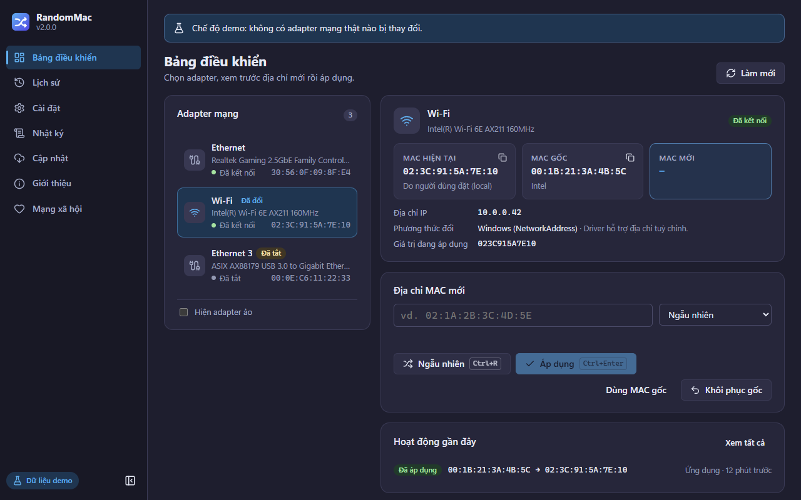

# RandomMac

[](https://github.com/poli0981/randomizerMAC/actions/workflows/ci.yml)
[](https://github.com/poli0981/randomizerMAC/releases/latest)
[](../../../LICENSE)

RandomMac đổi địa chỉ MAC của card Ethernet và Wi-Fi để các mạng bạn không kiểm soát không thể nhận
ra thiết bị qua địa chỉ phần cứng. Đây là ứng dụng desktop nhỏ gọn cho **Windows 10/11 và Linux
(Ubuntu, Fedora và các bản phân phối khác)**, kèm công cụ dòng lệnh để viết script.

> **v2.0.0 được viết lại hoàn toàn** (Rust + Tauri 2 thay cho .NET/WinUI 3): hỗ trợ Linux, có CLI,
> bộ cài nhỏ hơn ~20 lần, cập nhật tự động có chữ ký và rất nhiều bản sửa lỗi. Đang dùng 1.x? Xem
> [Nâng cấp từ 1.x](#nâng-cấp-từ-1x). English: [README](../../../README.md).

> Bản dịch tiếng Việt do AI tạo và có thể chưa chính xác tuyệt đối — bản tiếng Anh là bản gốc.



<sub>Ảnh chụp dùng dữ liệu demo có sẵn trong app; không hiển thị adapter thật.</sub>

## Tính năng

- **Đổi địa chỉ trong hai bước.** Tạo địa chỉ xem trước, kiểm tra hãng và cảnh báo, rồi áp dụng.
  Mọi thay đổi đều được xác minh; nếu driver bỏ qua, RandomMac tự hoàn tác và cho biết lý do.
- **Chế độ tạo MAC.** Ngẫu nhiên (địa chỉ quản trị cục bộ — mọi driver đều nhận, mặc định), *giữ hãng
  hiện tại*, hoặc *giả lập hãng* (Apple, Samsung, Intel… 59 hãng, 11 nghìn tiền tố từ IEEE). Bạn cũng
  có thể tự nhập địa chỉ theo mọi định dạng phổ biến.
- **Địa chỉ gốc thật.** Địa chỉ phần cứng (vĩnh viễn) được đọc từ driver nên **Khôi phục** dùng được
  bất cứ lúc nào — kể cả với thay đổi do công cụ khác hoặc RandomMac 1.x tạo ra.
- **Tự động hoá.** Đổi MAC các adapter đã chọn khi đăng nhập, mỗi *N* phút khi app đang chạy, và
  (tuỳ chọn) khôi phục tất cả khi thoát. **Khôi phục tất cả** có ngay trong khay hệ thống.
- **Danh sách chặn.** Chặn địa chỉ cụ thể hoặc tiền tố hãng, cho mọi adapter hoặc từng adapter;
  nhập/xuất được.
- **Lịch sử.** Mọi thay đổi từ app, CLI hay tự động hoá, có tìm kiếm và xuất CSV/JSON.
- **Công cụ dòng lệnh.** `randommac-cli list | show | random | set | restore | inspect | vendors |
  history`, có `--json` và mã thoát ổn định.
- **Linux đúng cách.** NetworkManager (bền vững, theo từng kết nối) hoặc iproute2 (tạm thời), chỉ hỏi
  quyền polkit khi cần — bản thân cửa sổ không bao giờ chạy với quyền root.
- **Giao diện dễ dùng.** Giao diện sáng/tối/theo hệ thống, tiếng Anh và tiếng Việt, phím tắt, menu
  khay, thông báo hệ thống, xem log trực tiếp, thông tin chẩn đoán để dán vào báo lỗi.
- **Riêng tư.** Không thu thập dữ liệu. Yêu cầu mạng duy nhất là kiểm tra cập nhật, có thể tắt.

## Tải về

Tải từ [bản phát hành mới nhất](https://github.com/poli0981/randomizerMAC/releases/latest).

| Hệ điều hành | Tệp | Ghi chú |
|---|---|---|
| Windows 10/11 (x64) | `RandomMac_<version>_x64-setup.exe` | Khuyên dùng. Cài cho mọi người dùng vào `Program Files`. |
| Windows 10/11 (x64) | `RandomMac_<version>_x64_en-US.msi` | Cho triển khai tập trung/cài im lặng. |
| Ubuntu 24.04+, Debian 13+ | `RandomMac_<version>_amd64.deb` | Cài `randommac` và `randommac-cli`. |
| Fedora 41+ | `RandomMac-<version>-1.x86_64.rpm` | Cài `randommac` và `randommac-cli`. |
| Linux khác (x86_64) | `RandomMac_<version>_amd64.AppImage` | Chạy trực tiếp; tự cập nhật. |
| Chỉ CLI | `randommac-cli-<version>-<target>.zip` / `.tar.gz` | Một tệp thực thi, không có giao diện. |

### Cài đặt

**Windows** — chạy tệp setup. Bộ cài chưa được ký số nên SmartScreen có thể báo *"Windows protected
your PC"*: chọn **More info → Run anyway** sau khi [kiểm tra tệp tải về](#kiểm-tra-tệp-tải-về). Nếu
máy thiếu WebView2 (hiếm trên Windows 10, có sẵn trên Windows 11), bộ cài sẽ tự tải.

**Ubuntu / Debian**

```bash
sudo apt install ./RandomMac_2.0.0_amd64.deb
```

**Fedora**

```bash
sudo dnf install ./RandomMac-2.0.0-1.x86_64.rpm
```

**AppImage**

```bash
chmod +x RandomMac_2.0.0_amd64.AppImage
./RandomMac_2.0.0_amd64.AppImage
```

### Kiểm tra tệp tải về

Mỗi bản phát hành có `SHA256SUMS.txt` và [chứng thực nguồn gốc bản build](https://docs.github.com/actions/security-guides/using-artifact-attestations-to-establish-provenance-for-builds)
chứng minh các tệp được build bởi workflow phát hành của repo này.

```bash
sha256sum --ignore-missing -c SHA256SUMS.txt
```

```bash
gh attestation verify RandomMac_2.0.0_x64-setup.exe --repo poli0981/randomizerMAC
```

Trên Windows không có `sha256sum`: chạy `Get-FileHash .\RandomMac_2.0.0_x64-setup.exe -Algorithm SHA256`
trong PowerShell rồi so với dòng tương ứng trong `SHA256SUMS.txt`.

### Cập nhật

RandomMac kiểm tra cập nhật tối đa mỗi ngày một lần (Cài đặt → Cập nhật → *Tự động kiểm tra cập
nhật*; khi tắt, app không tự kết nối mạng). Bản cập nhật được ký và xác minh trước khi cài: bộ cài
Windows và AppImage cập nhật tại chỗ; với `.deb`/`.rpm`, RandomMac tải gói về và cài bằng `apt`/`dnf`
sau khi hỏi mật khẩu.

### Yêu cầu hệ thống

| | Windows | Linux |
|---|---|---|
| Hệ điều hành | Windows 10 hoặc 11, 64-bit | x86_64, glibc 2.39+ (Ubuntu 24.04+, Debian 13+, Fedora 41+) |
| Runtime | Microsoft Edge WebView2 (tự cài nếu thiếu) | WebKitGTK 4.1, GTK 3 (gói tự kéo về; AppImage đã kèm) |
| Đổi địa chỉ | Quyền Administrator (một lần hỏi UAC mỗi lần mở) | NetworkManager, hoặc iproute2 + polkit (`pkexec`) |
| Dung lượng | ~15 MB | ~15 MB (cộng WebKitGTK nếu chưa có) |

## Nâng cấp từ 1.x

RandomMac 1.x (WinUI 3/Velopack) không tự cập nhật lên 2.0 được. Hãy nâng cấp thủ công một lần:

1. **Cài 2.0 trước** bằng `RandomMac_2.0.0_x64-setup.exe`. Lần chạy đầu tiên, app tự nhập cài đặt,
   lịch sử và danh sách chặn của 1.x từ `%LOCALAPPDATA%\RandomMac`, đồng thời thay tác vụ khởi động
   của 1.x (vốn chạy tệp nằm trong thư mục người dùng ghi được với quyền Administrator).
2. **Sau đó gỡ "RANDOM MAC" 1.x** trong *Settings → Apps → Installed apps*. Gỡ 1.x sẽ xoá
   `%LOCALAPPDATA%\RandomMac`, vì vậy đừng làm trước bước 1 nếu muốn giữ dữ liệu.

Địa chỉ do 1.x đặt vẫn còn hiệu lực; RandomMac 2.0 khôi phục được. Cài đặt → Dữ liệu → *Nhập từ
RandomMac 1.x* cho phép nhập lại bất cứ lúc nào.

## Sử dụng

1. Mở RandomMac. Trên Windows, đồng ý hộp thoại quyền Administrator (nếu từ chối, app mở ở chế độ chỉ
   xem và có nút khởi động lại với quyền Admin).
2. Chọn adapter ở **Bảng điều khiển**. Adapter ảo (VPN, Hyper-V, VirtualBox, Docker…) bị ẩn trừ khi
   bạn bật *Hiện adapter ảo*.
3. **Tạo** (`Ctrl+R`) địa chỉ mới hoặc tự nhập. RandomMac hiển thị hãng và cảnh báo nếu địa chỉ là
   multicast, nằm trong danh sách chặn, hoặc không phải *quản trị cục bộ* (Wi-Fi trên Windows chỉ nhận
   địa chỉ quản trị cục bộ).
4. **Áp dụng** (`Ctrl+Enter`). Adapter kết nối lại trong vài giây; RandomMac kiểm tra kết quả và tự
   hoàn tác nếu driver không nhận địa chỉ.
5. **Khôi phục** đưa adapter về địa chỉ phần cứng. Menu khay cũng có thể đổi ngẫu nhiên hoặc khôi phục
   adapter đang chọn, và *Khôi phục tất cả adapter*.

| Phím tắt | Chức năng |
|---|---|
| `Ctrl+1` … `Ctrl+7` | Bảng điều khiển, Lịch sử, Cài đặt, Nhật ký, Cập nhật, Giới thiệu, Mạng xã hội |
| `Ctrl+R` | Tạo địa chỉ xem trước |
| `Ctrl+Enter` | Áp dụng địa chỉ xem trước |
| `F5` | Làm mới danh sách adapter |
| `Esc` | Đóng hộp thoại |

### Cách hoạt động

- **Windows** — đặt tham số driver `NetworkAddress` (giống *Device Manager → Advanced → Network
  Address*) rồi khởi động lại thiết bị. Thay đổi giữ nguyên sau khi khởi động lại máy cho tới khi bạn
  khôi phục.
- **Linux, NetworkManager** — đặt `cloned-mac-address` cho hồ sơ kết nối đang hoạt động rồi kích hoạt
  lại. Bền vững cho kết nối đó.
- **Linux, iproute2** — `ip link set … address …` qua `pkexec`. Tạm thời: địa chỉ phần cứng quay lại
  sau khi khởi động lại máy hoặc nạp lại driver.

Chi tiết: [docs/ARCHITECTURE.md](../../ARCHITECTURE.md).

## Công cụ dòng lệnh

`randommac-cli` dùng chung bộ máy, dữ liệu và lịch sử với app.

- Windows: `C:\Program Files\RandomMac\randommac-cli.exe` — chạy trong terminal **có quyền Admin**
  để đổi địa chỉ.
- Linux (`.deb`/`.rpm`): `/usr/bin/randommac-cli` — không cần `sudo`; NetworkManager hoặc `pkexec` sẽ
  hỏi quyền khi cần.
- Mọi nơi: tệp nén `randommac-cli-<version>-<target>` trên trang phát hành.

```bash
randommac-cli list                          # adapter vật lý (thêm --all để xem cả adapter ảo)
randommac-cli show "Wi-Fi"                  # chi tiết, hãng, địa chỉ gốc
randommac-cli random "Wi-Fi"                # địa chỉ ngẫu nhiên quản trị cục bộ
randommac-cli random wlp2s0 --mode vendor --vendor apple
randommac-cli set eth0 02:11:22:33:44:55
randommac-cli restore "Wi-Fi"
randommac-cli inspect 3c:22:fb:12:34:56     # hãng, bit unicast/LAA, dùng được cho Wi-Fi hay không
randommac-cli history --limit 10 --json
```

Adapter có thể chỉ định bằng tên, id hoặc MAC hiện tại. Tuỳ chọn chung: `--json`, `--data-dir <DIR>`,
`--method auto|networkmanager|iproute2` (Linux), `--mock` (adapter giả lập, không thay đổi gì).

| Mã thoát | Ý nghĩa |
|---|---|
| 0 | Thành công |
| 1 | Lỗi khác |
| 2 | Dòng lệnh không hợp lệ |
| 3 | Thiếu quyền hoặc đã huỷ xác thực |
| 4 | Không tìm thấy adapter / không xác định duy nhất |
| 5 | Thay đổi thất bại hoặc đã bị hoàn tác |
| 6 | Địa chỉ không hợp lệ hoặc bị chặn |

## Dữ liệu được lưu ở đâu

| | Windows | Linux |
|---|---|---|
| Cài đặt, danh sách chặn | `%LOCALAPPDATA%\io.github.poli0981.randommac\` | `~/.config/io.github.poli0981.randommac/` |
| Lịch sử, địa chỉ gốc | `%LOCALAPPDATA%\io.github.poli0981.randommac\` | `~/.local/share/io.github.poli0981.randommac/` |
| Log (5 × 2 MB) | `%LOCALAPPDATA%\io.github.poli0981.randommac\logs\` | `~/.local/share/io.github.poli0981.randommac/logs/` |

Các tệp là JSON thuần, được ghi nguyên tử. Tệp hỏng được giữ lại dưới tên `*.corrupt-<thời điểm>` và
thay bằng giá trị mặc định thay vì làm app bị lỗi. Cài đặt → Dữ liệu cho phép xuất tất cả thành một
tệp zip.

## Hỏi đáp

**Địa chỉ Wi-Fi trên Windows không đổi.**
Driver Wi-Fi trên Windows chỉ nhận địa chỉ *quản trị cục bộ* — chữ số hex thứ hai phải là `2`, `6`,
`A` hoặc `E` (ví dụ `x2:…`). Chế độ *Ngẫu nhiên* mặc định luôn tạo địa chỉ như vậy; chế độ theo hãng
thì không. Hãy kiểm tra thêm *Settings → Network & internet → Wi-Fi → Random hardware addresses*: khi
bật, Windows tự thay địa chỉ. Một số driver bỏ qua hoàn toàn thiết lập này; RandomMac phát hiện, khôi
phục trạng thái trước đó và báo *"Driver bỏ qua địa chỉ mới"*.

**Mạng bị ngắt một lúc.**
Bình thường — adapter phải khởi động lại (Windows) hoặc kết nối phải kích hoạt lại (Linux) để địa chỉ
mới có hiệu lực.

**Nên dùng phương thức nào trên Linux?**
*Tự động* (mặc định) dùng NetworkManager cho thiết bị nó quản lý và đang có kết nối, còn lại dùng
iproute2. Thay đổi qua NetworkManager được lưu trong hồ sơ kết nối và giữ sau khi khởi động lại; qua
iproute2 thì chỉ tạm thời.

**Cửa sổ trắng trơn trên Linux với card NVIDIA.**
RandomMac tự đặt `WEBKIT_DISABLE_DMABUF_RENDERER=1` khi dùng driver NVIDIA độc quyền. Nếu vẫn trắng,
chạy bằng `WEBKIT_DISABLE_COMPOSITING_MODE=1 randommac`.

**Không thấy biểu tượng khay trên GNOME.**
Cài extension *AppIndicator and KStatusNotifierItem Support* (Fedora:
`sudo dnf install gnome-shell-extension-appindicator`, rồi đăng xuất và đăng nhập lại). Khi không có
khay, đóng cửa sổ sẽ thoát RandomMac.

**Có chạy bằng root trên Linux được không?**
Cửa sổ app từ chối chạy bằng root (không nên chạy web engine với quyền root). App chỉ xin quyền cho
chính thao tác đổi địa chỉ. Với máy chủ không có giao diện, dùng `randommac-cli` (kèm `sudo` nếu không
có NetworkManager/polkit).

**Đổi địa chỉ MAC có hợp pháp không?**
Ở hầu hết các nơi là có — nhưng một số mạng cấm trong điều khoản sử dụng. Đọc
[Tuyên bố miễn trừ](../../../DISCLAIMER.md).

## Build từ mã nguồn

Cần Rust (phiên bản trong `rust-toolchain.toml` được rustup tự cài), Node.js 24 và các gói Tauri cần
cho hệ điều hành của bạn — xem [DEV_ENVIRONMENT.md](DEV_ENVIRONMENT.md).

```bash
git clone https://github.com/poli0981/randomizerMAC.git
cd randomizerMAC
npm ci
npm run tauri dev
```

## Ghi nhận AI

Ứng dụng được xây dựng và kiểm thử với sự hỗ trợ của AI **Anthropic Claude** (v1.0.0: Claude Opus
4.6; v1.1.x: Claude Opus 4.7; v2.0.0: Claude Opus 5.5 qua Claude Code — viết lại đa nền tảng). Nhà phát
triển (poli0981) chịu trách nhiệm review, kiểm thử trên máy thật/máy ảo và mọi quyết định cuối cùng.
Xem chi tiết trong [README tiếng Anh](../../../README.md#ai-acknowledgment).

## Pháp lý

[Giấy phép MIT](../../../LICENSE) · [Tuyên bố miễn trừ](../../../DISCLAIMER.md) · [EULA](../../../EULA.md) ·
[Chính sách bảo mật](../../../SECURITY.md) · [Quy tắc ứng xử](../../../CODE_OF_CONDUCT.md) ·
[Đóng góp](../../../CONTRIBUTING.md) · [Nhật ký thay đổi](../../../CHANGELOG.md)
